

  <picture>
    <source media="(prefers-color-scheme: dark)" srcset="assets/maguro-lockup-dark.png">
    <source media="(prefers-color-scheme: light)" srcset="assets/maguro-lockup-light.png">
    
  </picture>

<h1 align="center">Maguro</h1>

高速で軽量な、Windows向けマルチペイン・ファイルマネージャ。

> **Maguro は efww の [efww/grids](https://github.com/efww/grids) のフォークです。** 実行ファイル名（`maguro.exe`）、ウィンドウクラス、設定フォルダ、ホットキー（Win+Shift+E）が異なるため、元の Grids の設定に触れずに並べて使えます。

  
  
  
  

  <a href="README.md">English</a> | 日本語 | <a href="README.ko.md">한국어</a>

  <picture>
    <source media="(prefers-color-scheme: dark)" srcset="docs/images/hero_dark.ja.png">
    
  </picture>

どのペインも本物の Windows エクスプローラーです。右クリックメニュー、ドラッグ＆ドロップ、サムネイル、Windows 標準のコピー／移動ダイアログがそのまま動きます。起動時はペインひとつ。必要になったらレイアウトを広げてください。

## 機能

### 1. レイアウトギャラリー — プリセットすべて

ペインひとつから始めて、組み込みの格子（最大 4×4）を選べます。境界をドラッグしてサイズ変更。名前付きセッションにはレイアウト・フォルダ・列・色ラベルが入り、開くと今のタブの横にウィンドウタブが増えます。

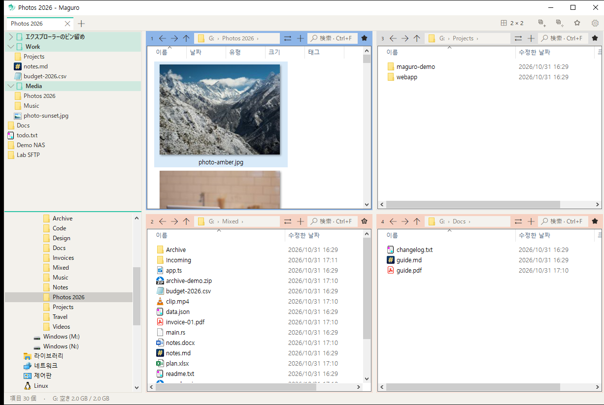

<table>
<tr>
<td></td>
<td></td>
<td></td>
</tr>
<tr>
<td></td>
<td></td>
<td></td>
</tr>
<tr>
<td></td>
<td></td>
<td></td>
</tr>
<tr>
<td></td>
<td></td>
<td></td>
</tr>
</table>

### 2. ウィンドウタブと、ペイン内の入れ子タブ

ウィンドウ全体の Chrome 風タブに加え、各ペインの中にもタブがあります。タブ名はアクティブなフォルダから付き、ツールチップにフルパスが出ます。タブの複製、別ウィンドウへの移動、セッション保存もできます。

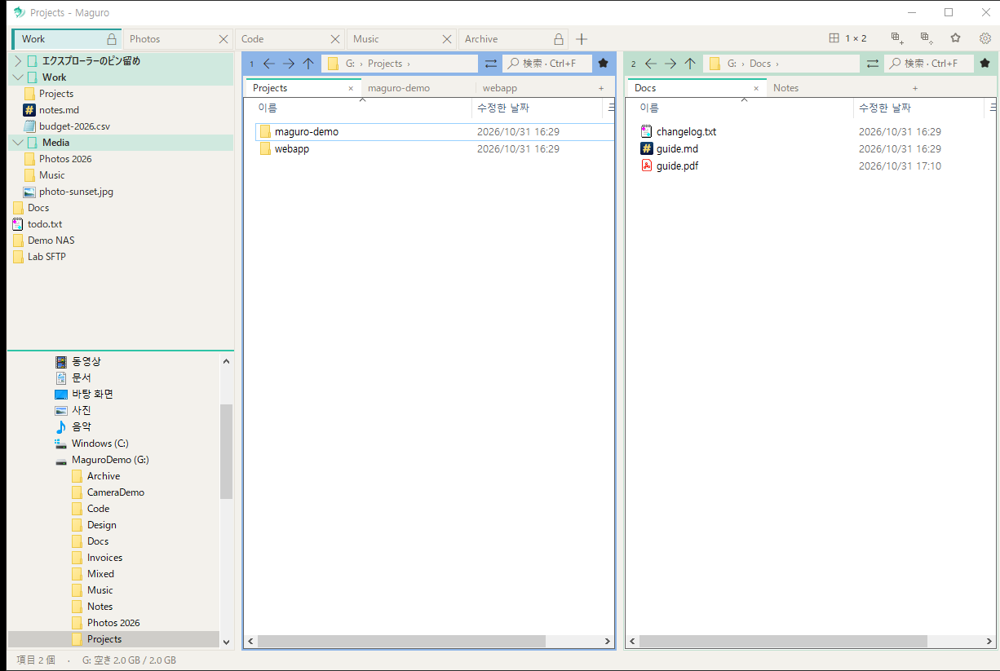

### 3. タブの固定名・ロック・色

タブをダブルクリック、または右クリック → 名前の変更で好きな名前を固定できます。ロックすれば誤って閉じにくくなります。色を付けると、関連する作業が一目で分かります。

### 4. ペイン番号をドラッグして入れ替え — Ctrl+ドラッグで複製

ペイン番号バッジをつまんで別ペインに落とすと場所が入れ替わります。**Ctrl** を押しながらドラッグすると、入れ替えではなくそのペインを複製します。

  
  

### 5. ペインごとの色

ペインごとにアクセント色を付けられます。ソースと行き先を間違えにくい、忙しいマルチペイン向きの仕込みです。

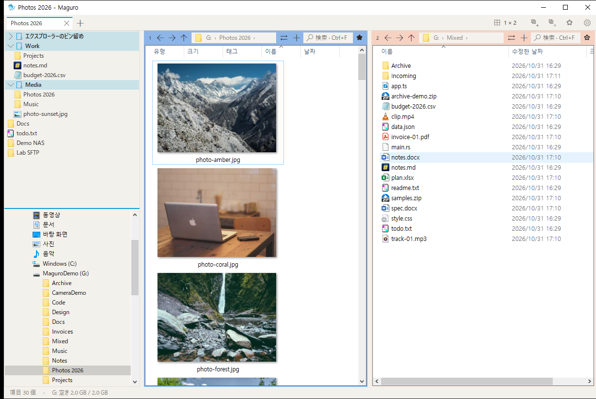

### 6. 速さのための設計

このポータブルデモでのコールドスタート実測は **607 ms**。ネットワークフォルダへの貼り付けやドラッグは robocopy を使えます（設定 → ファイル操作。既定はオフ）。右クリック → 高速貼り付けは常にこちらで、Maguro 独自の進捗と上書き／スキップ／キャンセルが出ます。

**Everything 連携のペイン検索。** ペインで Ctrl+F すると入力のたびに絞り込み。サブフォルダをオンにすると [voidtools Everything](https://www.voidtools.com/) に聞いて一瞬で結果を出し、Everything が無ければディスクを歩きます。

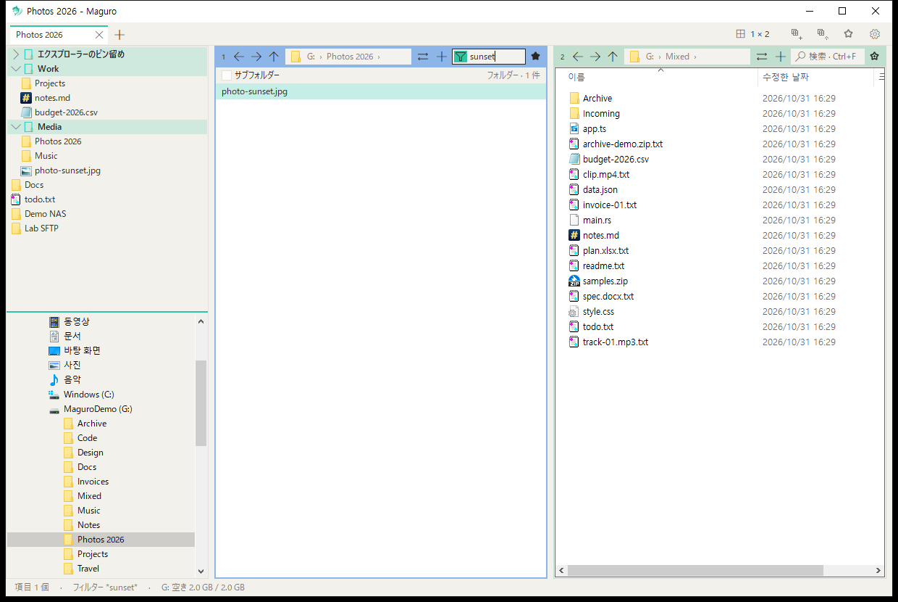

### 7. お気に入り — フォルダもファイルも、グループで

サイドバーは上下半分。上がお気に入り、下がフォルダツリー。お気に入りにはエクスプローラーのクイックアクセスに加え、自分で作ったグループ（フォルダもファイルも入れられ、ドラッグで並べ替え）が入ります。Ctrl+B でクイック一覧。パネルにファイルやフォルダを落とすとピン留めされます。

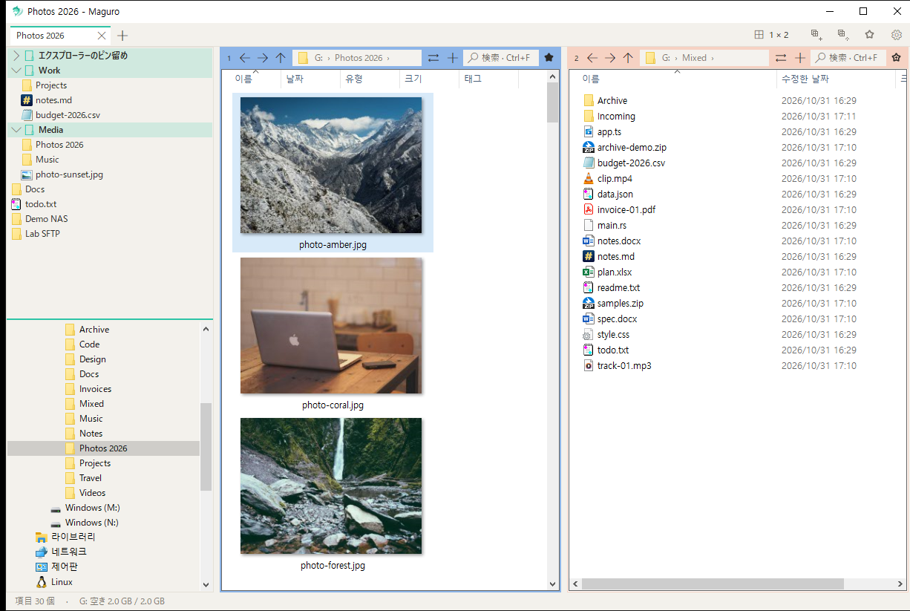

### 8. クイックプレビュー

Space または F3 で画像、PDF、Office、HTML、Markdown、コード、CSV、ZIP、HWP/HWPX（Hancom）などをプレビュー。Ctrl+ホイールで拡大（10–800%）、ドラッグでパン、ホイールでスクロール、←/→ で前後のファイルへ。

  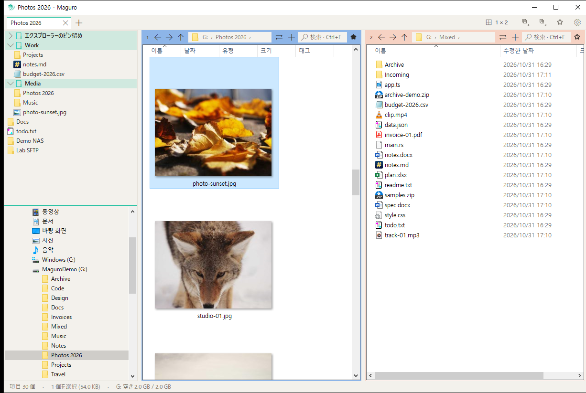
  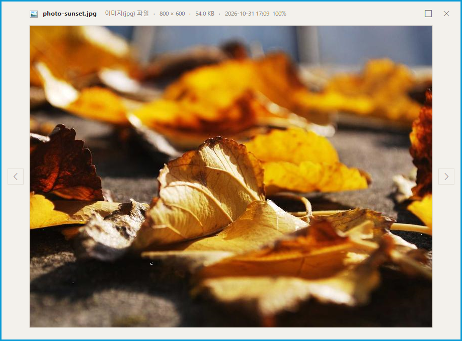

### 9. カスタムできる右クリックメニュー

設定 → 右クリックメニュー項目で、Maguro 独自コマンドの表示／非表示を選べます。メニューをすっきりさせても、全部戻しても構いません。

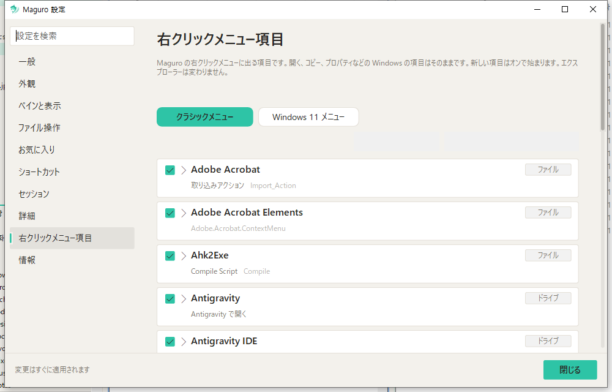

### 10. 名前のプレビュー付き一括リネーム

ファイルを選んで Ctrl+Shift+R。検索／置換、連番、拡張子、プリセットを変えるたびに、確定前の新しい名前が一覧で更新されます。

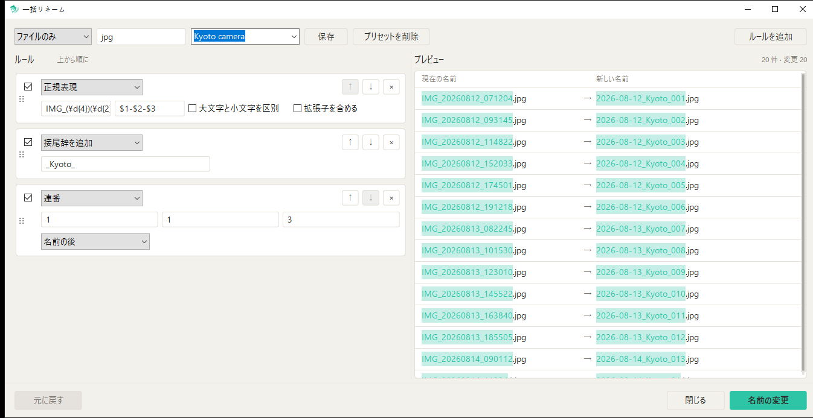

### 11. サーバー接続

お気に入りパネル（またはグループ）を右クリック → **サーバー接続を追加…**。SMB と WebDAV は普通の Windows フォルダとして開きます。SFTP と FTP は rclone と WinFsp でマウントしたあと、プレビューも右クリックも高速コピーも他のフォルダと同じように使えます。パスワードは Windows 資格情報マネージャーだけに置き、`maguro.json` には書きません。

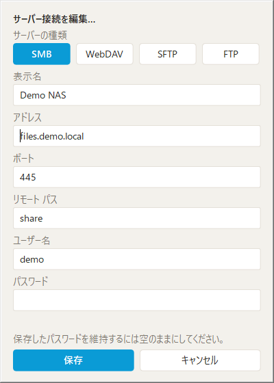

### テーマとアクセント

Windows に従うライト／ダーク、テーマごとにアクセント色が六つ（既定はセルリアン `#0A9BD6`）。設定ウィンドウは English・日本語・한국어 に対応しています。

<table>
<tr>
<td>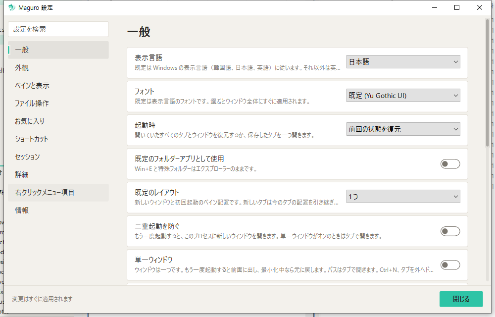</td>
<td>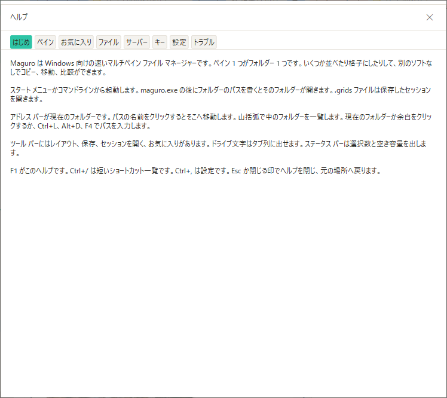</td>
</tr>
<tr>
<td colspan="2">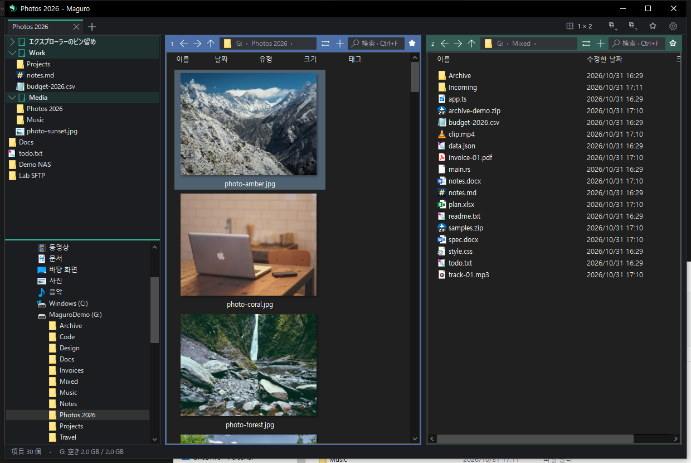</td>
</tr>
</table>

📦 **小さな単体 exe。** インストール不要です。

## インストール

[Releases](https://github.com/Samek86/maguro/releases/latest) から最新の `maguro.exe` を入手し、任意のフォルダに置いて実行してください。リリースは zip ではなく、exe と `maguro.exe.sha256` を上げています。

コード署名が無いため、初回は SmartScreen が警告することがあります。**詳細情報 → 実行** を選んでください。

**動作環境:** Windows 10（1903 以降）または Windows 11、x64。SFTP/FTP には [rclone](https://rclone.org/) と [WinFsp](https://winfsp.dev/) も必要です（接続追加時に Maguro が導入を案内できます）。

設定は `%APPDATA%\Maguro\maguro.json` にあります。`maguro.exe` の隣に `portable.txt` を置くと、設定も exe の隣に置かれます。名前付きセッションは exe 隣の `maguro-sessions` フォルダ内の `.grids` ファイルです。

ソースからビルドする場合は [CONTRIBUTING.md](CONTRIBUTING.md) を参照してください。

## キーボードショートカット

既定値です。設定 → ショートカットですべて変更できます。

| 区分 | キー | 動作 |
| --- | --- | --- |
| **タブ** | Ctrl+T | 新しいタブ |
|  | Ctrl+W | タブを閉じる |
|  | Ctrl+Tab / Ctrl+Shift+Tab | 次／前のタブ |
|  | Ctrl+Shift+T | 閉じたタブを開き直す |
| **ペイン** | Alt+1…9 | ペインにフォーカス |
|  | Ctrl+\ | レイアウト選択 |
| **プレビュー** | Space / F3 | プレビュー |
|  | Esc / Space / F3 | プレビューを閉じる |
| **ファイル** | Ctrl+Shift+C | フルパスをコピー |
|  | Ctrl+Shift+R | 一括リネーム |
|  | Num+ または Ctrl+Shift+A / Num− / Num* | パターンで選択／解除／反転 |
|  | Ctrl+Alt+N | 新しいテキストファイル |
|  | Ctrl+Shift+N, F7 | 新しいフォルダ |
|  | Ctrl+Alt+C | WinMerge で二つのペインを比較 |
|  | F2, Del, Ctrl+C / V, F5 | エクスプローラーと同じ。F5 はアクティブペインを再読み込みし、失敗したネットワークフォルダも再試行 |
| **その他** | Ctrl+B | クイックお気に入り |
|  | Ctrl+S | このタブを保存 |
|  | Ctrl+, | 設定 |
|  | F1 / Ctrl+/ | ヘルプ／ショートカット一覧 |
|  | Ctrl+N | 新しいウィンドウ |
|  | Win+Shift+E | Maguro を前面に（グローバル） |

## 既知の問題

**Maguro を管理者として実行しないでください。** PowerToys Mouse Crosshairs のようなツールは、権限の高い Maguro ウィンドウ上でカーソルを追えません（UIPI）。Maguro は通常実行するか、Maguro と PowerToys の両方を管理者で実行してください。

## 設定

タブ行の歯車が表示メニューを開きます。設定はその中にあります（`Ctrl+,`）。

言語（自動、English、および各言語ファイル）、フォント、ライト／ダーク、アクセント、ショートカットは設定で変更します。古い Grids 設定からの移行、書き込み方、`maguro.json` のキー一覧は [docs/settings.md](docs/settings.md) にあります。

## 言語ファイル

English はプログラムに組み込まれており、フォールバックです。韓国語・日本語・フランス語・ドイツ語は `lang/lang.ko.ini` などとして同梱されます。初回起動時とバージョンが変わったときに、設定隣の `lang` フォルダへその四ファイルを書き直します。`lang.xx.user.ini` や自分で追加した `lang.xx.ini` には触れません。

ファイルは UTF-8 です。行は `key = text`。[meta] の `name` は言語一覧の表示名、`font` は任意の UI フォント。無いキーは English を使います。`lang.xx.user.ini` が上に載り、優先されます。

## ロードマップ

- [ ] コード署名付きビルド — 初回の SmartScreen 警告をなくす
- [x] English・한국어・日本語以外のインターフェース言語

## クレジット

Maguro は efww の [efww/grids](https://github.com/efww/grids) のフォークです。

[Q-Dir](https://www.softwareok.com/?seite=Freeware/Q-Dir) と [voidtools Everything](https://www.voidtools.com/) に着想を得ています。Maguro は独立したプロジェクトであり、Q-Dir およびその作者とは無関係です。

## ライセンス

[MIT](LICENSE) · © 2026 efww, Samek86