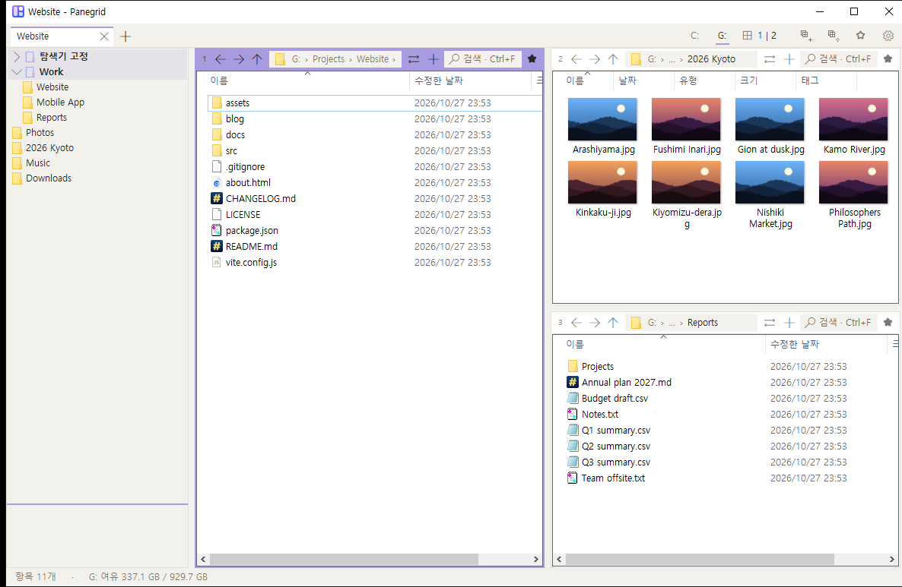
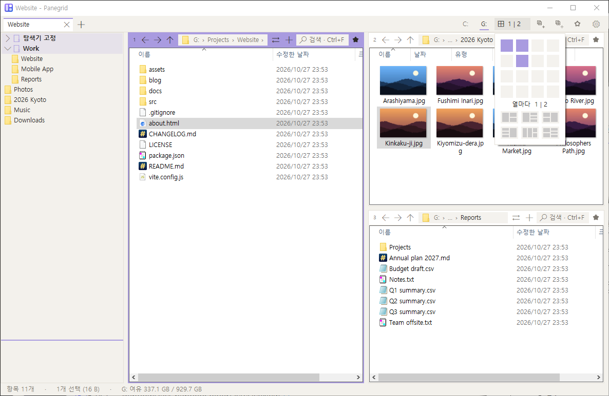
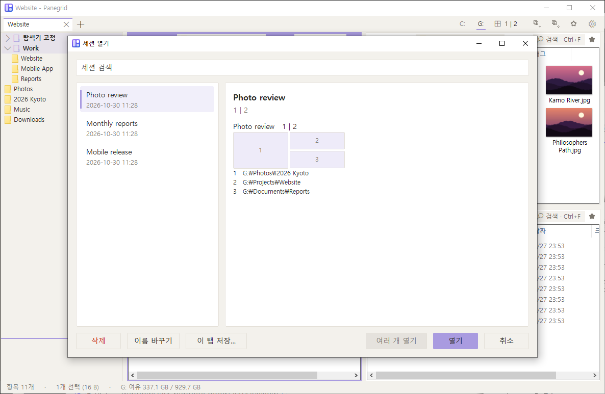
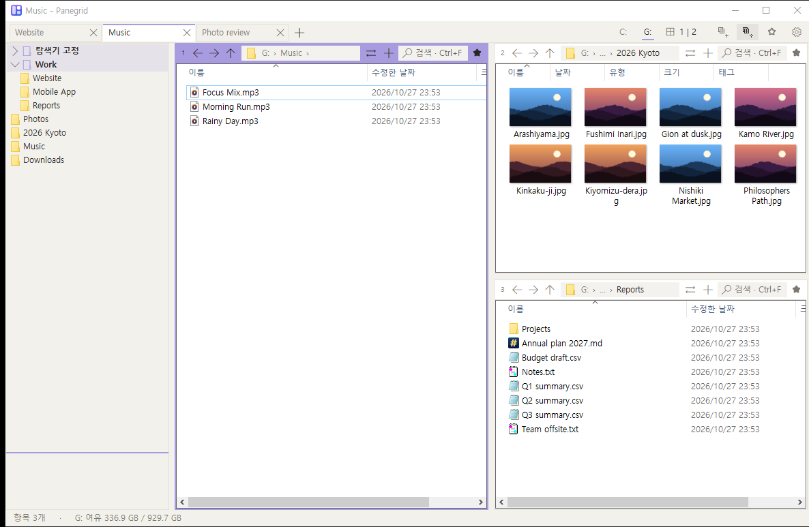
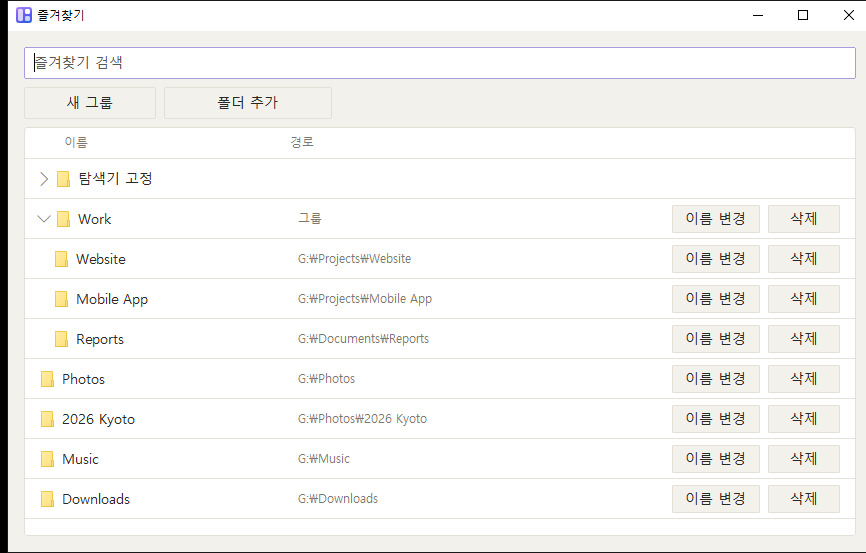
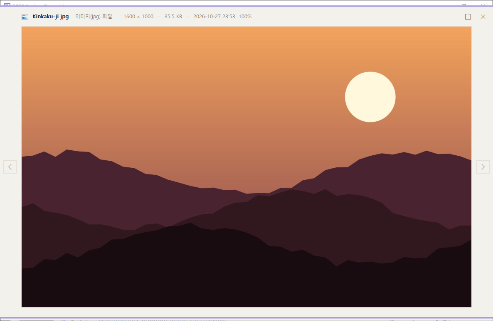
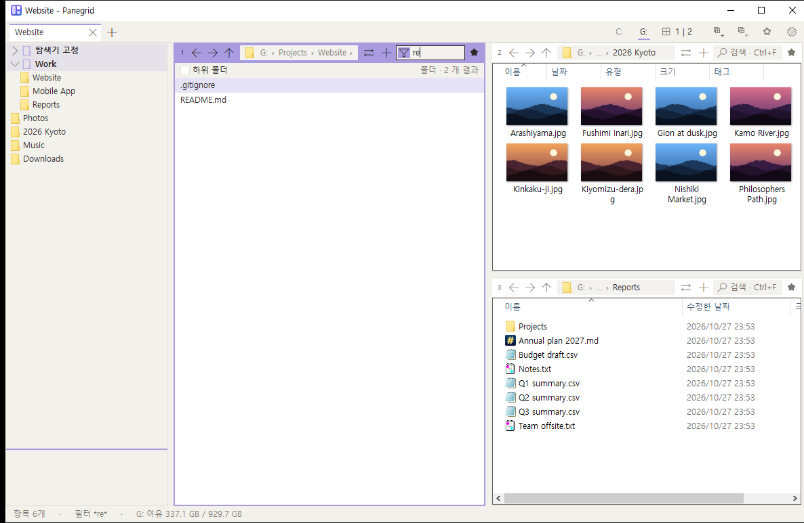
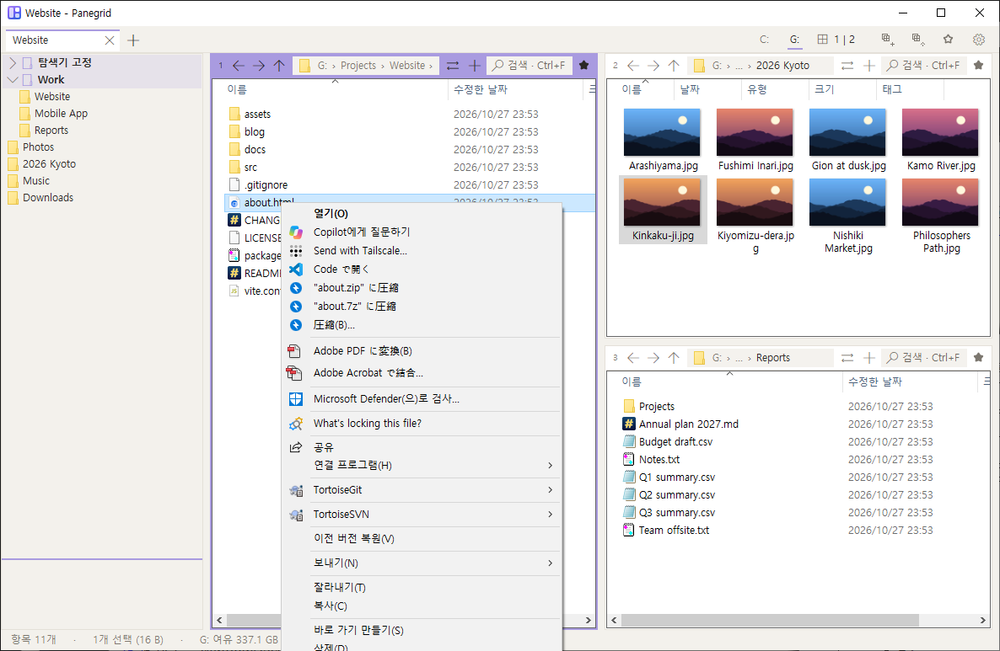
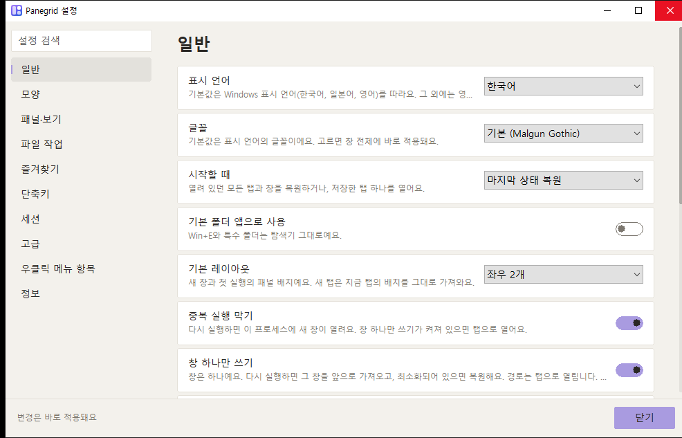

  <picture>
    <source media="(prefers-color-scheme: dark)" srcset="assets/panegrid-lockup-dark.png">
    <source media="(prefers-color-scheme: light)" srcset="assets/panegrid-lockup-light.png">
    
  </picture>

<h1 align="center">Panegrid</h1>

Windows용 빠르고 가벼운 다중 패널 파일 관리자.

> **Panegrid는 efww의 [efww/grids](https://github.com/efww/grids) 포크입니다.** 실행 파일 이름(`panegrid.exe`), 창 클래스, 설정 폴더, 단축키(Win+Shift+E)를 따로 쓰므로, 원래 Grids의 설정을 건드리지 않고 나란히 실행할 수 있습니다.

  
  
  
  

  <a href="README.md">English</a> | 한국어

  <picture>
    <source media="(prefers-color-scheme: dark)" srcset="docs/images/hero_dark.ko.png">
    
  </picture>

각 패널은 진짜 Windows 탐색기 화면입니다. 탐색기 우클릭 메뉴 전체, 끌어다 놓기, 썸네일, Windows 표준 복사·이동 창이 그대로 동작합니다. 한 창에 패널을 최대 16개 배치하고, 지금 탭을 세션으로 저장하세요.

## 기능

### 🧩 다중 패널 레이아웃과 세션

최대 4열 × 4칸. 레이아웃 선택기를 누르거나 끌어서 배치하고, 경계를 끌어 크기를 바꾸며, 패널 번호를 끌어 패널을 재배치합니다(Ctrl+끌기는 패널 탭을 다른 칸으로 복사). 지금 탭의 배치·폴더·열·색 라벨을 이름 붙인 세션으로 저장하고, 열면 현재 탭 옆에 새 탭이 생깁니다.

패널이 하나일 때 ⇄ 버튼은 탭을 둘로 나눕니다. 선택한 폴더(선택이 없거나 파일만 선택했으면 현재 폴더)가 같은 열·보기 설정으로 오른쪽 새 패널에 열립니다. 패널이 둘 이상이면 ⇄는 기존 메뉴를 그대로 씁니다.

<table><tr><td></td><td></td></tr></table>

### 🗂️ 이름이 저절로 붙는 탭

크롬 스타일 창 탭과 패널 안의 탭. 탭 이름은 활성 폴더를 따라가고(경로는 툴팁), 더블클릭이나 우클릭 → 이름 바꾸기로 직접 이름을 정하고 탭 색도 고릅니다. 탭 잠금, 탭 복제(Ctrl+Alt+K), 새 창으로 이동, 세션으로 저장도 됩니다. 창 탭은 기본 폭이 넓어져(135px) 이름이 더 많이 보입니다.

### ⭐ 탐색기 고정 항목까지 담은 즐겨찾기 팝업

툴바의 ★가 테마에 맞춘 즐겨찾기 팝업을 엽니다. 맨 위에 탐색기 즐겨찾기 고정 항목, 그 아래 내 그룹이 있고 중첩과 끌어서 순서 바꾸기를 지원합니다. 항목에 마우스를 올리면 전체 위치가 보이고, 패널이나 탐색기에서 파일·폴더를 끌어다 놓으면 즐겨찾기에 추가됩니다. Ctrl+B는 빠른 즐겨찾기 목록을 엽니다.

### 👁️ 빠른 미리보기

스페이스나 F3으로 사진, PDF, Office, HTML, 마크다운, 코드, CSV, ZIP, HWP/HWPX(한글과컴퓨터) 등을 봅니다. Ctrl+휠 확대(10–800%), 끌어서 이동, 휠 스크롤, ←/→ 다음 파일. 창 크기를 바꾸면 기억합니다.

### 🔎 Everything으로 패널 검색

어느 패널에서나 Ctrl+F로 입력하는 대로 걸러지고, 하위 폴더를 켜면 voidtools Everything이 즉시 찾아 줍니다(Everything이 없으면 디스크를 훑습니다).

### 🖱️ 어디서나 진짜 탐색기

셸 확장까지 포함한 탐색기 우클릭 메뉴 전체(빈 곳에는 속성도), 그리고 Windows 표준 IFileOperation 창으로 다른 패널에 복사·이동(최대 10,000개).

### ⚡ 작은 편의 기능

- **주소 표시줄 전체 경로.** 패널 주소 표시줄이 좁아 `…`로 줄어들면, 마우스를 올려 전체 경로를 봅니다. 즐겨찾기 행과 잠긴 탭에도 호버 툴팁이 있습니다.
- **폴더별 보기 기억.** 정렬·열·보기 모드·아이콘 크기·그룹화가 그 폴더를 다시 열 때 복원됩니다(설정 옆 `folder-views.json`에 저장, 기본 켜짐).
- **마우스 옆 버튼.** 폴더 패널에서 뒤로·앞으로가 동작하며, 원격 데스크톱(RDP)에서도 됩니다.
- **우클릭 메뉴의 첫 지연 감소.** 실행 직후와 오래 쉰 뒤에 셸 컨텍스트 메뉴를 백그라운드에서 미리 준비합니다.
- **테마 전환 시 기록 유지.** 라이트/다크를 바꿔도 뒤로·앞으로와 보고 있던 폴더는 그대로입니다.
- **선택적 업데이트 확인.** 시작 시 GitHub Releases에서 새 `panegrid.exe`를 확인할 수 있고(SHA-256 검증), 설치를 제안합니다.
- **다음 실행 때 충돌 보고.** 서드파티 셸 확장 때문에 Panegrid가 종료되면 보고서가 원인을 알려 주며, `panegrid.json`의 `blocked_shell_extensions`에 DLL 이름을 넣어 Panegrid 안에서만 막을 수 있습니다.

### 🎨 테마와 강조색

Windows를 따르는 라이트·다크, 테마마다 강조색 6가지, 패널별 색, English·한국어·日本語 설정 창.

📦 **작은 단일 exe.** 설치 없음.

## 설치

[Releases](https://github.com/Samek86/panegrid/releases/latest)에서 최신 `panegrid.exe`를 받습니다. 아무 폴더에 두고 실행합니다. 작은 단일 exe — 설치할 것이 없습니다. 릴리스는 zip이 아니라 이 exe와 SHA-256 확인 파일 `panegrid.exe.sha256`을 올립니다.

코드 서명이 없는 exe라 처음 실행할 때 Windows SmartScreen 경고가 뜰 수 있습니다. **추가 정보 → 실행**을 누르세요.

**요구 사항:** Windows 10(1903 이상) 또는 Windows 11, x64.

설정은 `%APPDATA%\Panegrid\panegrid.json`에 있습니다. `panegrid.exe` 옆에 `portable.txt`라는 파일을 두면 `panegrid.json`을 exe 옆에 둡니다. 이름 붙인 세션은 exe 옆 `panegrid-sessions` 폴더의 `.grids` 파일로 남고, 있던 `sessions` 폴더의 `.grids` 파일은 한 번 복사됩니다.

소스에서 빌드하는 방법은 [CONTRIBUTING.ko.md](CONTRIBUTING.ko.md)에 있습니다.

## 단축키

기본값입니다. 설정 → 단축키에서 모두 바꿀 수 있습니다.

| 분류 | 키 | 동작 |
| --- | --- | --- |
| **탭** | Ctrl+T | 새 탭 |
|  | Ctrl+W | 탭 닫기 |
|  | Ctrl+Tab / Ctrl+Shift+Tab | 다음 / 이전 탭 |
|  | Ctrl+Shift+T | 닫은 탭 다시 열기 |
|  | Ctrl+Alt+K | 탭 복제 |
|  | 탭 더블클릭 | 탭 이름 바꾸기 |
| **패널** | Ctrl+PgDn / Ctrl+PgUp | 다음 / 이전 패널 |
|  | Ctrl+1 … 9 | 1~9번 패널로 |
|  | Alt+Shift+방향키 | 그 방향 패널로 이동 |
|  | Ctrl+Alt+Shift+방향키 | 그 방향 패널과 자리 바꾸기 |
|  | Ctrl+Shift+M | 패널 크게 / 복원 |
| **패널 탭** | Ctrl+Alt+T / Ctrl+Alt+W | 새 / 닫기 패널 탭 |
|  | Ctrl+Alt+PgDn / PgUp | 다음 / 이전 패널 탭 |
| **이동** | Alt+← / Alt+→ | 뒤로 / 앞으로 |
|  | Alt+↑ / Alt+↓ | 상위 폴더 / 최근 폴더 |
|  | Ctrl+L, Alt+D, F4 | 주소창 |
| **보기** | Ctrl+F | 이 폴더 검색 (하위 폴더 → Everything) |
|  | Space / F3 | 빠른 미리보기 |
|  | F6 / Shift+F6 | 다음 / 이전 포커스 |
|  | Ctrl+H | 숨김 파일 표시 |
|  | Ctrl+Shift+E | 왼쪽 패널 |
|  | Ctrl+Shift+O | 탐색기 창의 폴더 열기 |
| **미리보기** | Ctrl+휠 | 확대 10–800% |
|  | Ctrl+0 | 확대 초기화 |
|  | 끌기 | 확대한 사진 끌어서 이동 |
|  | 휠, ↓, PgDn, Home / End | 스크롤 |
|  | ← / → | 이전 / 다음 파일 |
|  | Esc / Space / F3 | 닫기 |
| **파일** | Ctrl+Shift+C | 전체 경로 복사 |
|  | Ctrl+Shift+R | 일괄 이름 바꾸기 |
|  | Num+ or Ctrl+Shift+A / Num− / Num* | 패턴으로 선택 / 해제 / 반전 |
|  | Ctrl+Alt+N | 새 텍스트 문서 |
|  | Ctrl+Shift+N, F7 | 새 폴더 |
|  | Ctrl+Alt+C | WinMerge로 두 패널 비교 |
|  | F2, Del, Ctrl+C / V, F5 | 탐색기와 동일. F5는 파일 목록·주소창·필터·폴더 트리·즐겨찾기에서 활성 패널을 새로고침하고, 네트워크 폴더 오류면 그 경로를 다시 시도 (복사한 그림을 Ctrl+V 하면 이 폴더에 PNG로 저장) |
| **기타** | Ctrl+B | 빠른 즐겨찾기 목록 |
|  | Ctrl+S | 이 탭 저장 |
|  | Ctrl+, | 설정 |
|  | F1 / Ctrl+/ | 단축키 도움말 / 목록 |
|  | Ctrl+N | 새 창 |
|  | Win+Shift+E | Panegrid를 앞으로 (전역) |

## 알려진 문제

**Panegrid를 관리자 권한으로 실행하지 않는 것을 권합니다.** PowerToys 마우스 십자선 같은 도구가 Panegrid 위에서 커서를 따라오지 않고 클릭한 자리에 멈춘다는 제보가 있었습니다. Panegrid를 관리자 권한으로 실행했을 때만 생깁니다. Windows는 보안상 권한이 낮은 프로그램이 권한이 높은 창의 마우스 움직임을 받지 못하게 막기 때문에(UIPI), 일반 권한으로 도는 PowerToys가 관리자 권한으로 도는 Panegrid 창 위에서는 마우스 움직임을 받지 못합니다. 두 프로그램의 권한을 맞추면 되고, 방법은 둘 중 하나입니다.

1. **권장**: Panegrid를 관리자 권한 없이 실행. `panegrid.exe`를 우클릭 → **관리자 권한으로 실행**으로 열지 말고, 바로 가기나 `panegrid.exe`의 **속성 → 호환성**에서 **관리자 권한으로 이 프로그램 실행** 체크를 해제합니다.
2. Panegrid를 꼭 관리자로 써야 한다면 PowerToys도 관리자로: **PowerToys 설정 → 일반 → 항상 관리자 권한으로 실행**을 켜고 PowerToys를 다시 시작합니다.

## 설정

탭 줄의 톱니가 보기 메뉴를 엽니다. 설정은 그 메뉴에 있습니다(`Ctrl+,`).

언어(자동, English, 그리고 언어 파일마다), 글꼴, 라이트/다크 테마, 단축키는 설정에서 바꿉니다. 이전 Grids 설정 이전, 파일 저장 방식, `panegrid.json` 키 전체 표는 [docs/settings.ko.md](docs/settings.ko.md)에 있습니다.

## 언어 파일

영어는 프로그램에 들어 있고, 번역이 없으면 영어로 나옵니다. 한국어, 일본어, 프랑스어, 독일어는 `lang/lang.ko.ini`, `lang/lang.ja.ini`, `lang/lang.fr.ini`, `lang/lang.de.ini`로 들어 있습니다. 처음 실행할 때, 그리고 버전이 바뀔 때마다, 이 네 파일을 설정 파일 옆 `lang` 폴더에 씁니다(`%APPDATA%\Panegrid\lang`, `portable.txt`가 있으면 `panegrid.exe` 옆). 이 네 파일은 항상 덮어씁니다. `lang.xx.user.ini`와, 직접 넣은 다른 `lang.xx.ini`는 쓰거나 덮거나 지우지 않습니다.

파일은 UTF-8입니다(앞의 BOM은 무시). 한 줄은 `key = text`입니다. `=` 뒤의 공백 하나가 구분자입니다. `\\`는 역슬래시, `\n`은 줄바꿈입니다. `#`이나 `;`로 시작하는 줄은 주석입니다. `[meta]`의 `name`은 언어 목록에 보이는 이름입니다. `[meta]`의 `font`는 선택 글꼴입니다(한국어·일본어 기본은 맑은 고딕, Yu Gothic UI이고, 그 외는 Segoe UI). 없는 키는 영어를 씁니다.

`lang.xx.user.ini`(예: `lang.ko.user.ini`)는 `lang.xx.ini` 위에 얹히고, 같은 키는 이쪽이 이깁니다. `lang.es.ini`를 넣으면 스페인어가 목록에 나옵니다. 자동은 Windows 표시 언어의 ISO 코드와 맞는 파일이 있으면 그 언어를, 없으면 영어를 씁니다. 저장값 `en`, `ko`, `ja`는 그대로 동작합니다.

## 로드맵

- [ ] `panegrid.exe`에 코드 서명을 넣어, 처음 실행할 때 SmartScreen 경고가 나오지 않게 합니다
- [x] English, 한국어, 日本語 이외의 표시 언어

## 감사

Panegrid는 efww의 [grids](https://github.com/efww/grids)를 포크한 프로그램입니다.

[Q-Dir](https://www.softwareok.com/?seite=Freeware/Q-Dir)와 [voidtools Everything](https://www.voidtools.com/)에서 영감을 받았습니다. Panegrid는 Q-Dir 및 그 제작자와 관계없는 독립 프로젝트입니다.

## 라이선스

[MIT](LICENSE)
