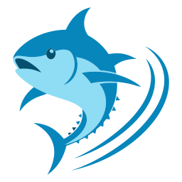
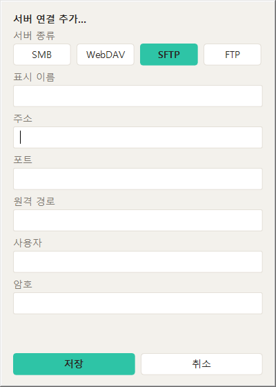
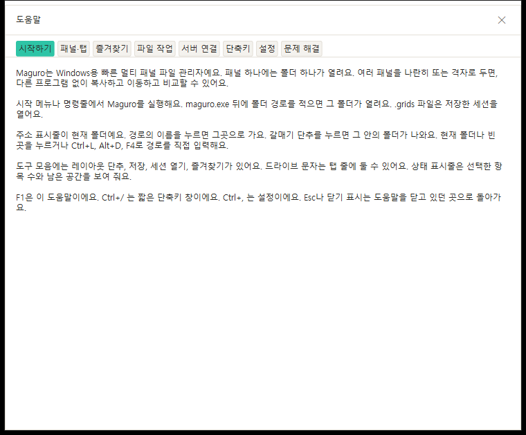
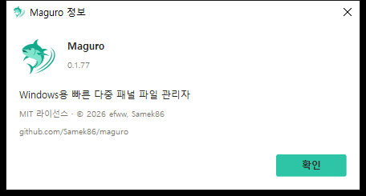
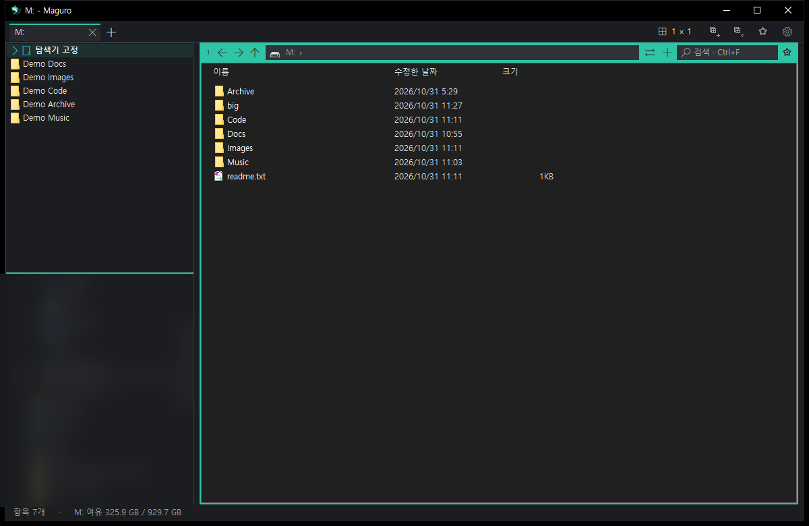

  <picture>
    <source media="(prefers-color-scheme: dark)" srcset="assets/maguro-lockup-dark.png">
    <source media="(prefers-color-scheme: light)" srcset="assets/maguro-lockup-light.png">
    
  </picture>

<h1 align="center">Maguro</h1>

빠르고 가벼운 Windows용 다중 패널 파일 관리자.

> **Maguro는 efww의 [efww/grids](https://github.com/efww/grids) 포크입니다.** exe 이름(`maguro.exe`), 창 클래스, 설정 폴더, 단축키(Win+Shift+E)가 달라 원본 Grids와 설정을 건드리지 않고 함께 쓸 수 있습니다.

  
  
  
  

  <a href="README.md">English</a> | 한국어

  <picture>
    <source media="(prefers-color-scheme: dark)" srcset="docs/images/hero_dark.ko.png">
    
  </picture>

모든 패널은 진짜 Windows 탐색기 뷰입니다. 전체 우클릭 메뉴, 끌어서 놓기, 미리보기 썸네일, Windows 복사/이동 대화상자가 그대로 동작합니다. Maguro는 기본적으로 패널 하나로 열리고, 필요할 때 레이아웃을 늘리면 됩니다.

## 기능

### 🧩 레이아웃과 세션

패널 하나로 시작한 뒤 최대 4×4 다중 패널 격자로 키울 수 있습니다. 경계를 끌어 크기를 바꾸고, 패널 번호를 끌어 자리를 바꿉니다. 현재 탭(레이아웃·폴더·열·색 라벨)을 이름 있는 세션으로 저장하고, 세션을 열면 창 탭이 옆에 추가됩니다.

패널이 하나일 때 ⇄ 버튼은 탭을 나눕니다. 선택한 폴더(없으면 현재 폴더)가 같은 열·보기로 오른쪽 새 패널에 열립니다. 패널이 둘 이상이면 ⇄는 메뉴를 유지합니다.

### 🗂️ 이름이 저절로 붙는 탭

크롬 스타일 창 탭과 패널 안 탭. 탭 이름은 활성 폴더에서 오고, 툴팁에 전체 경로가 보입니다. 더블클릭 또는 우클릭 → 이름 바꾸기로 고정 이름을 달거나, 잠그거나, 복제(Ctrl+Alt+K)하거나, 새 창으로 옮기거나, 세션으로 저장하거나, 탭 색을 고를 수 있습니다.

### ⭐ 즐겨찾기와 폴더 트리

사이드바는 위·아래 절반으로 나뉩니다. 위는 즐겨찾기, 아래는 폴더 트리. 즐겨찾기에는 탐색기 빠른 액세스 고정과 직접 만든 그룹(중첩·끌어 정렬)이 들어갑니다. Ctrl+B는 빠른 즐겨찾기 목록을 엽니다. 패널에 파일·폴더를 놓으면 즐겨찾기에 추가됩니다.

### 🌐 서버 연결

즐겨찾기 패널(또는 그룹)을 우클릭 → **서버 연결 추가…**. SMB·WebDAV는 일반 Windows 폴더로 열립니다. SFTP·FTP는 rclone과 WinFsp로 마운트한 뒤 미리보기·우클릭 메뉴·빠른 복사까지 다른 폴더처럼 씁니다. 비밀번호는 Windows 자격 증명 관리자에만 두고 `maguro.json`에는 쓰지 않습니다.

### 👁️ 빠른 미리보기

Space 또는 F3으로 그림, PDF, Office, HTML, Markdown, 코드, CSV, ZIP, HWP/HWPX(한컴) 등을 미리봅니다. Ctrl+휠로 확대(10–800%), 끌어서 이동, 휠로 스크롤, ←/→로 파일 이동.

### 🔎 Everything으로 패널 검색

패널에서 Ctrl+F로 입력하는 대로 걸러집니다. 하위 폴더를 켜면 voidtools Everything에 물어 바로 결과를 받고, Everything이 없으면 디스크를 직접 걷습니다.

### 🖱️ 어디서나 진짜 탐색기

탐색기 전체 우클릭 메뉴(셸 확장 포함)와 Windows 표준 IFileOperation 복사/이동 대화상자.

**빠른 복사.** 네트워크 폴더로 붙여넣기·끌기는 robocopy를 쓸 수 있습니다(설정 → 파일 작업, 기본 끔). 우클릭 → 빠른 붙여넣기는 항상 쓰고, Maguro 자체 진행률과 덮어쓰기/건너뛰기/취소를 제공합니다. 이동은 먼저 복사한 뒤 성공했을 때만 원본을 지웁니다.

### ⚡ 작은 편의 기능

- **도움말(F1).** 단축키·팁·사용법이 탭으로 나뉜 도움말. 브라우저 없음.
- **정보.** 버전, 라이선스, 그리고 링크가 아닌 일반 텍스트 주소 `github.com/Samek86/maguro`.
- **호버 전체 경로.** 주소 표시줄이 `…`일 때 올리면 전체 경로.
- **폴더별 보기 기억.** 정렬·열·보기·아이콘 크기·그룹이 다음에도 그대로.
- **마우스 옆 버튼.** 패널에서 뒤로/앞으로. 원격 데스크톱에서도.
- **우클릭 메뉴 예열.** 시작 후·오래 쉰 뒤 셸 메뉴를 미리 준비.
- **테마 전환이 기록을 유지.** 라이트/다크를 바꿔도 뒤로/앞으로와 현재 폴더를 지치지 않음.
- **안티앨리어싱.** 어떤 DPI에서도 선명한 UI.
- **선택적 업데이트 확인.** GitHub Releases에서 새 `maguro.exe`를 확인하고 SHA-256으로 검증.
- **다음 실행의 크래시 보고.** Maguro를 쓰러뜨린 타사 셸 확장을 알려 주고, Maguro 안에서만 그 DLL을 막을 수 있음.

### 🎨 테마와 강조색

Windows를 따르는 라이트/다크, 테마마다 강조색 여섯(기본 민트 `#2EC4A6`), 패널별 색, English·한국어·日本語 설정 창.

<table>
<tr>
<td></td>
<td></td>
</tr>
<tr>
<td></td>
<td></td>
</tr>
</table>

📦 **작은 단일 exe.** 설치할 것이 없습니다.

## 설치

[Releases](https://github.com/Samek86/maguro/releases/latest)에서 최신 `maguro.exe`를 받아 아무 폴더에 두고 실행합니다. 릴리스는 zip이 아니라 exe와 `maguro.exe.sha256`을 올립니다.

코드 서명이 없어 처음 실행 때 SmartScreen이 경고할 수 있습니다. **추가 정보 → 실행**을 고르세요.

**요구 사항:** Windows 10 (1903 이상) 또는 Windows 11, x64. SFTP/FTP는 [rclone](https://rclone.org/)과 [WinFsp](https://winfsp.dev/)도 필요합니다(연결 추가 때 Maguro가 설치를 안내할 수 있음).

설정은 `%APPDATA%\Maguro\maguro.json`에 있습니다. `maguro.exe` 옆에 `portable.txt`를 두면 설정이 exe 옆에 생깁니다. 이름 있는 세션은 exe 옆 `maguro-sessions` 폴더의 `.grids` 파일입니다.

소스에서 빌드하려면 [CONTRIBUTING.md](CONTRIBUTING.md)를 보세요.

## 단축키

기본값이며, 설정 → 단축키에서 모두 바꿀 수 있습니다.

| 구분 | 키 | 동작 |
| --- | --- | --- |
| **탭** | Ctrl+T | 새 탭 |
|  | Ctrl+W | 탭 닫기 |
|  | Ctrl+Tab / Ctrl+Shift+Tab | 다음 / 이전 탭 |
|  | Ctrl+Shift+T | 닫은 탭 다시 열기 |
| **패널** | Alt+1…9 | 패널 포커스 |
|  | Ctrl+\ | 레이아웃 고르기 |
| **미리보기** | Space / F3 | 미리보기 |
|  | Esc / Space / F3 | 미리보기 닫기 |
| **파일** | Ctrl+Shift+C | 전체 경로 복사 |
|  | Ctrl+Shift+R | 일괄 이름 바꾸기 |
|  | Num+ 또는 Ctrl+Shift+A / Num− / Num* | 패턴으로 선택 / 해제 / 반전 |
|  | Ctrl+Alt+N | 새 텍스트 파일 |
|  | Ctrl+Shift+N, F7 | 새 폴더 |
|  | Ctrl+Alt+C | WinMerge로 두 패널 비교 |
|  | F2, Del, Ctrl+C / V, F5 | 탐색기와 같음. F5는 활성 패널 다시 로드, 실패한 네트워크 폴더도 다시 시도 |
| **기타** | Ctrl+B | 빠른 즐겨찾기 |
|  | Ctrl+S | 이 탭 저장 |
|  | Ctrl+, | 설정 |
|  | F1 / Ctrl+/ | 도움말 / 단축키 목록 |
|  | Ctrl+N | 새 창 |
|  | Win+Shift+E | Maguro를 앞으로 (전역) |

## 알려진 문제

**Maguro를 관리자로 실행하지 마세요.** PowerToys Mouse Crosshairs 같은 도구는 권한이 높은 Maguro 창 위에서 커서를 따라가지 못합니다(UIPI). Maguro는 일반으로 실행하거나, Maguro와 PowerToys를 둘 다 관리자로 실행하세요.

## 설정

탭 줄의 톱니바퀴가 보기 메뉴를 엽니다. 설정은 그 메뉴에 있습니다(`Ctrl+,`).

언어(자동, English, 그리고 언어 파일마다), 글꼴, 라이트/다크, 강조색, 단축키는 설정에서 바꿉니다. 이전 Grids 설정 이전, 파일 저장 방식, `maguro.json` 키 전체 표는 [docs/settings.ko.md](docs/settings.ko.md)에 있습니다.

## 언어 파일

English는 프로그램에 들어가 있고 대체값입니다. 한국어·日本語·French·German은 `lang/lang.ko.ini` 등으로 배포됩니다. 처음 실행과 버전이 바뀔 때마다 설정 옆 `lang` 폴더에 그 네 파일을 다시 씁니다. `lang.xx.user.ini`나 직접 추가한 `lang.xx.ini`는 건드리지 않습니다.

파일은 UTF-8입니다. 줄은 `key = text`. `[meta]` `name`은 언어 목록 라벨, `[meta]` `font`는 선택 UI 글꼴. 없는 키는 English를 씁니다. `lang.xx.user.ini`가 위에 덮어씁니다.

## 로드맵

- [ ] 코드 서명 빌드 — SmartScreen이 처음 실행을 막지 않도록
- [x] English·한국어·日本語 밖의 인터페이스 언어

## 감사

Maguro는 efww의 [efww/grids](https://github.com/efww/grids) 포크입니다.

[Q-Dir](https://www.softwareok.com/?seite=Freeware/Q-Dir)과 [voidtools Everything](https://www.voidtools.com/)에서 영감을 받았습니다. Maguro는 독립 프로젝트이며 Q-Dir 및 제작자와 무관합니다.

## 라이선스

[MIT](LICENSE) · © 2026 efww, Samek86
