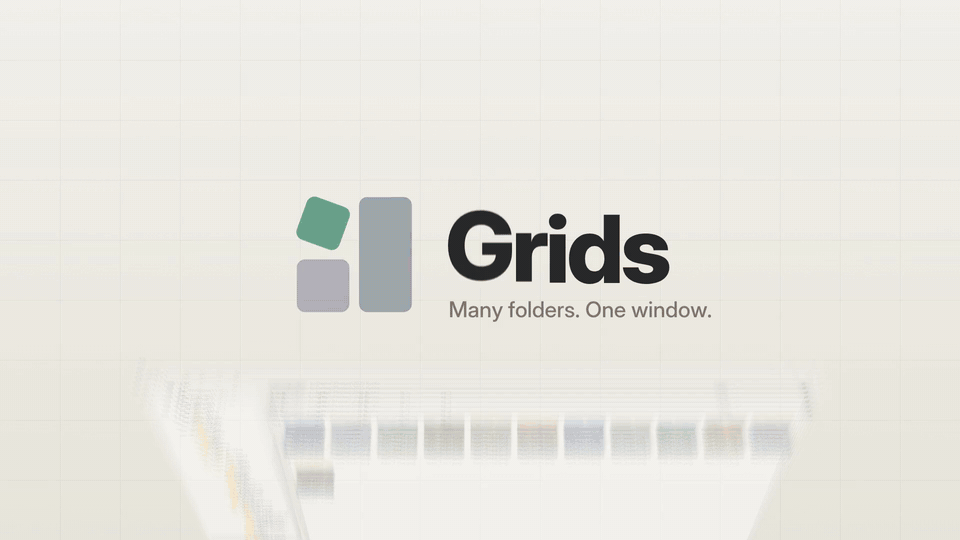
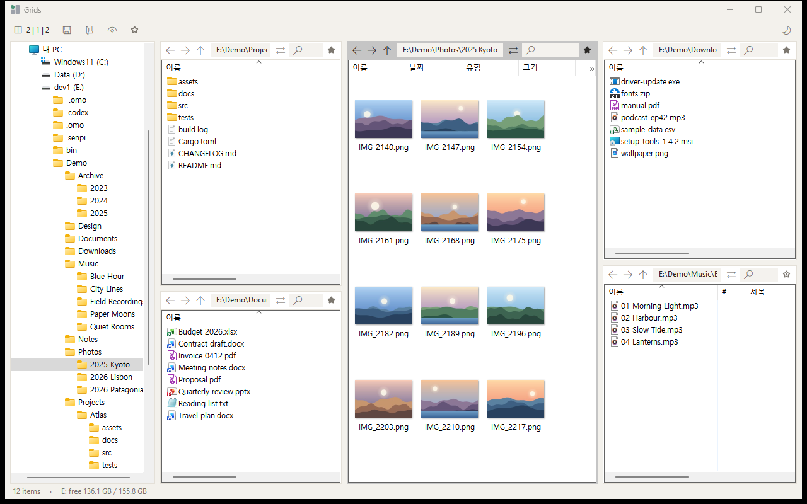
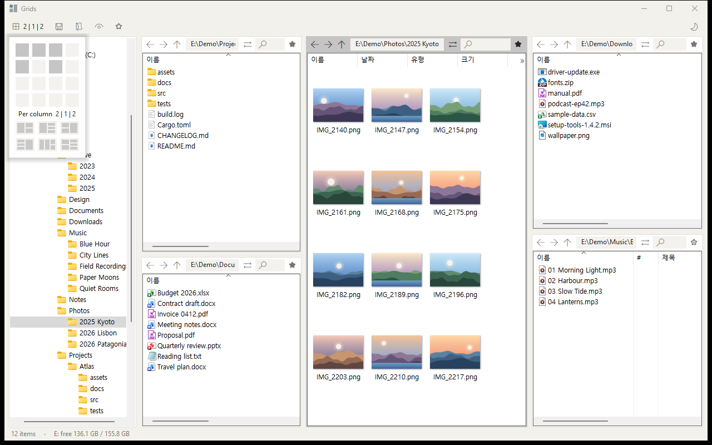
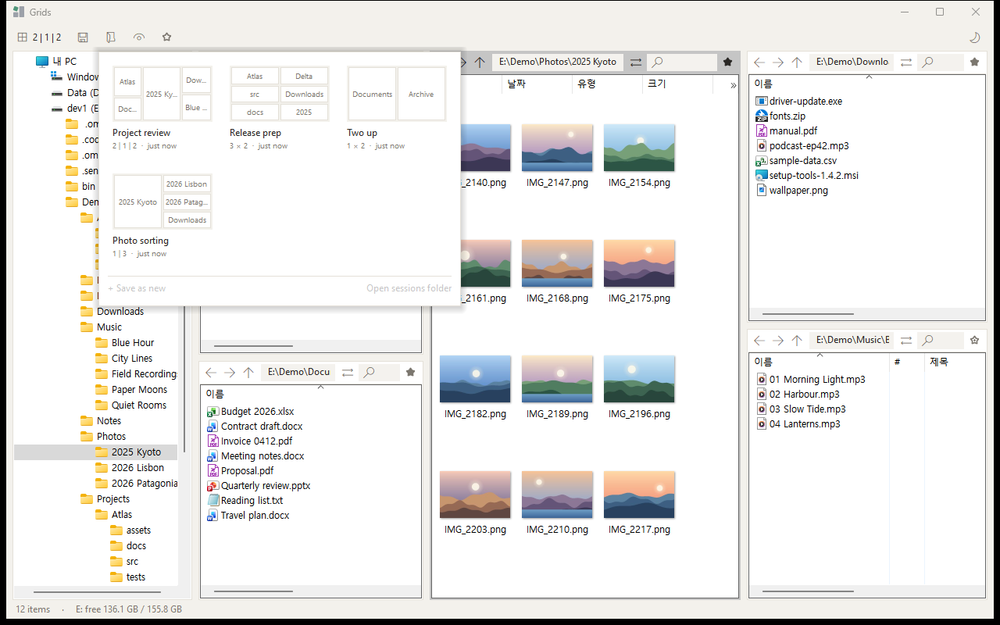
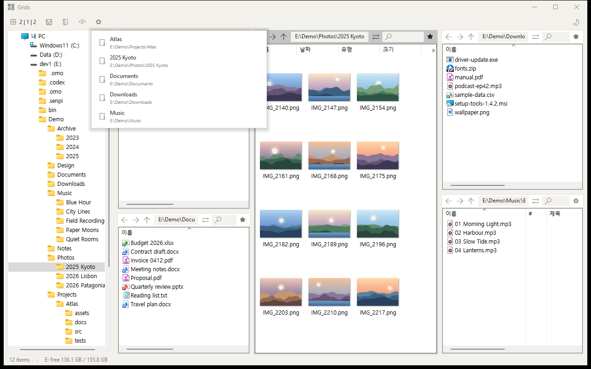
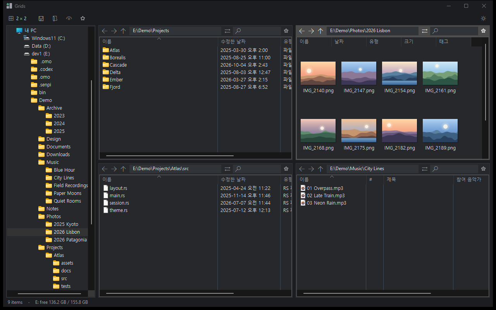

# Grids

A fast, lightweight multi-pane file manager for Windows. Up to 16 Explorer panes in one window, a folder tree on the left, and layouts you change with one drag. One small exe (about 450 KB), nothing to install.

[한국어](README.ko.md)

[](docs/demo.mp4)

▶ [Watch the full launch video with sound](docs/demo.mp4) (35 s)



Every pane is a real Windows Explorer view, so right-click menus, drag and drop, thumbnails, rename and copy progress all work exactly as they do in Explorer.

## Features

- **Free layouts**: up to 4 columns, each with its own number of panes (1 to 4). Click the layout button for an even grid, or press and drag across it to set each column; six presets for common setups.
- **Resizable everything**: drag any boundary between panes, the sidebar edge, or the divider between the folder tree and favourites; double-click a boundary to even it out.
- **Left panel**: the folder tree on top and favourites below, split by a draggable divider. Each part keeps a minimum height. The split is saved as `side_split` in `grids.json` and restored on startup. Settings hides the whole panel.
- **Folder tree** that follows the active pane and keeps the current folder's name in view, even in deep folders.
- **Per-pane toolbar**: address bar, back / forward / up, name filter (`*.pdf;*.txt` or any part of a name), open the selected folder in another pane (its columns come along, so you can set one pane up and copy it around) or copy / move the selected files to another pane's folder (up to 10,000), favourite toggle; drag a folder onto a pane's top bar to open it there.
- **Drive buttons**: C: D: E: … on the top toolbar open that drive in the active pane. The active pane's drive is underlined in the selection colour, and the buttons come and go as drives are plugged in or removed.
- **Bring to front**: Win+Alt+E brings Grids forward from any app; press it again to minimize. If a Grids dialog is open, that dialog comes forward. View shows a check only while the key is really registered, so one click retries after a failed start. The shortcut can be changed in Settings. `hotkey` in `grids.json` is on when the line is missing.
- **Sessions**: the layout, folders and each pane's columns (order, widths, sort) are saved automatically. A local folder that has been deleted opens the nearest folder that is still there, and the status line says which one was missing. Save named sessions and load them from cards that preview each layout; a green dot on the save button shows unsaved layout changes.
- **File extensions**: View → Show file extensions is Windows' own setting, the same one Explorer uses. It is also on the Settings page.
- **Columns are a pane setting**: their order, widths and sort stay as the pane moves from folder to folder, and any column can be made narrower than Explorer allows (Size stops at 90 px there).
- **Favourites**: star a folder from its pane header, or right-click a file or folder and choose Add to favourites, directly above Properties. The bottom of the left panel is that tree: make groups, nest them, and drag items between groups. Double-click a folder to open it here, or a file to open it with its usual app. Ctrl+B lists the same tree. Saved as `favorites_tree` in `grids.json`. An older flat list is moved into the root.
- **Folder sizes**: the status line also shows the total size of selected folders, summed in the background (F5 sums again; "partial" when some items couldn't be read).
- **Light and dark themes** with six selection colours each; the active pane is outlined and its header tinted. In the dark theme, plain group titles such as "Devices and drives" are drawn in a light colour with a thin rule. New installs follow Windows. View → Follow Windows light / dark is the check. The theme button picks light or dark by hand and turns following off. The lists are recoloured in place, so history, the filter, the selection, the scroll position and an address being typed stay.
- **Pane colour**: right-click the empty part of a pane header, or its number, and pick one of those six colours (or none). A thin strip sits in the gap above the buttons, and the number sits on a chip of that colour. Saved with the session, separate from the tab colour. The ⇄ menu shows the colour name.
- **Windows**: Ctrl+N opens another window in the same process. Each window has its own tabs. Drag a tab off the strip to move it, or use the tab menu. Closing the last window saves every window for the next launch; closing any other window just closes that one. A second `grids.exe` opens a new window here instead of a second process.
- **Portable**: settings live in `%APPDATA%\grids\grids.json`. Put a file named `portable.txt` next to `grids.exe` to keep `grids.json` beside the exe instead. An existing `grids.ini` is read once and renamed to `grids.ini.bak`. Named sessions stay `.grids` files in the `sessions` folder next to the exe. The file is replaced atomically, a failed write is tried again in 5 seconds, and a file that cannot be read is left alone (Retry or Cancel, never overwritten with defaults). Minimizing keeps a maximized window maximized. Unknown keys in the file are kept.
- **Settings**: the gear on the toolbar, or View → Settings. Language is Auto (Windows display language), English, 한국어, or 日本語, stored as `"lang": "auto"`, `"en"`, `"ko"`, or `"ja"`. An older `lang=ko` in `grids.ini` still loads as Korean. The Explorer parts inside each pane, such as column names and right-click menus, follow your Windows display language.

| Layout picker | Sessions | Favourites |
| --- | --- | --- |
|  |  |  |



## Download

Get `grids.exe` from [Releases](https://github.com/efww/grids/releases), put it in any folder and run it.

The exe is not code-signed, so Windows SmartScreen may warn the first time: choose **More info → Run anyway**.

**Requirements**: Windows 10 (1903 or later) or Windows 11, x64.

## Keyboard shortcuts

These are the defaults. Settings → Shortcuts can change any of them; the new key works immediately. Typing in the address bar, the filter, or a tab name is left alone. F6 still leaves those fields. Coming back from another app restores keyboard focus to the list, the address, the filter, the folder tree, or favourites. A click restores focus only when that click did not land on a control. The address and filter keep their text and caret.

| Keys | Action |
| --- | --- |
| Ctrl+T | New tab |
| Ctrl+W | Close the tab (a locked tab stays) |
| Ctrl+Tab / Ctrl+Shift+Tab | Next / previous tab |
| Ctrl+Shift+T | Reopen the last closed tab |
| Ctrl+PageDown / Ctrl+PageUp | Next / previous pane |
| Ctrl+1 … Ctrl+9 | Go to pane 1–9 (the number at the left of each pane header; hidden in very narrow panes) |
| Alt+Shift+← / → / ↑ / ↓ | Pane to the left / right / above / below |
| Alt+← / Alt+→ | Back / forward |
| Alt+↑ | Parent folder |
| Alt+↓ | Recent folders (all panes, newest first; right-click ← / → too) |
| Ctrl+L, Alt+D, F4 | Address bar, with the current folder's icon on the left when the field is wide enough. Idle, it shows the path as crumbs (`C: › Users › Public`): click a crumb to open it, `…` lists the folded parents, and the current folder or an empty part of the bar edits the path. Also `..`, a subfolder name, a file to open, or a command such as `cmd`, `wt`, `powershell` (runs in this pane's folder). A fragment such as `down` opens the best recent folder, or a favourite folder from the tree |
| Ctrl+F | Name filter. An empty filter shows “Name filter · Ctrl+F” until you type or focus it. ZIP, 7z, RAR and CAB match by name, the same as other files. Folders stay. The icon, or Alt+↓ while the filter has focus, opens file kinds (pictures, video, music, documents, archives, programs). With one file selected, "same type" is offered. Clear filter is in that menu. Alt+↓ elsewhere is still recent folders. A screen reader hears “Pane N address” and “Pane N name filter” |
| Num+ or Ctrl+Shift+A / Num− / Num* | Select, deselect, or invert files by a pattern such as `*.jpg`. The count stays on the status line for 5 seconds |
| F6 / Shift+F6 | Next / previous focus: file list, address, filter, folder tree, favourites |
| F3 | Quick look at the focused file. Arrow keys move to the next or previous file. Esc or F3 closes it and returns to the list. Holding F3 opens it once |
| Enter / Esc | Apply / cancel the address or filter |
| Ctrl+H | Show hidden files |
| Ctrl+Shift+E | Show or hide the left panel (folder tree and favourites). The width comes back as it was |
| Ctrl+Shift+O | Open the folders of open Explorer windows and tabs in panes, from the active pane on (also View menu; panes already showing one of them stay put) |
| Ctrl+S | Save the current session |
| Ctrl+B | Favourites list (↑/↓, Enter to open, Del to remove) |
| Ctrl+Shift+M | Maximize / restore the active pane (or double-click its header) |
| Ctrl+Shift+C | Copy the full path of the selected items (or of the current folder) |
| Ctrl+Alt+N | New text file |
| Ctrl+Shift+N | New folder |
| Ctrl+, | Settings |
| Ctrl+/ | Shortcut list, in the app's own colours. Holding the keys opens it once |
| F2, Del, Ctrl+C / X / V, F5 | Same as Explorer |

Double-clicking empty space in a pane goes up a folder (can be turned off in the view menu). A splitter under the pointer shows a thin line in the selection colour, including the left-panel edge and the divider between the folder tree and favourites.

## Build

Needs the Rust GNU toolchain (`x86_64-pc-windows-gnu`) and MSYS2's MinGW tools (`windres`, `dlltool`, `as` in `C:\msys64\mingw64\bin`).

```
build.cmd
```

This builds `target\release\grids.exe` and copies it to `grids.exe` in the project folder. `icon.py` redraws the app icon (`app.ico`).

## Credits

Inspired by [Q-Dir](https://www.softwareok.com/?seite=Freeware/Q-Dir). Grids is an independent project, not affiliated with Q-Dir or its author.

## License

[MIT](LICENSE)
