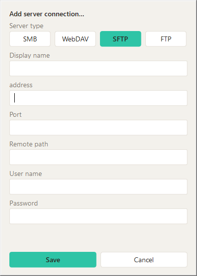
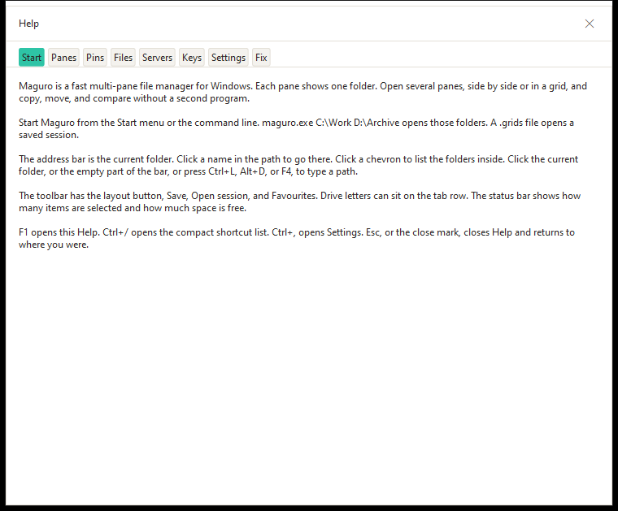
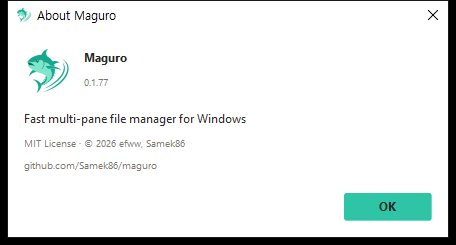
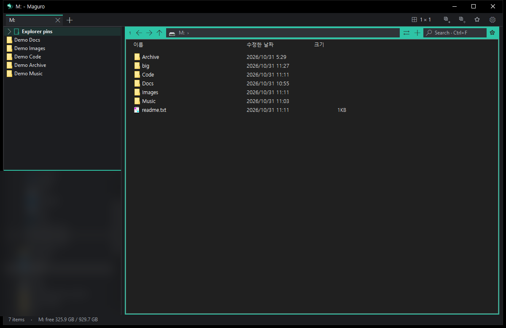

  <picture>
    <source media="(prefers-color-scheme: dark)" srcset="assets/maguro-lockup-dark.png">
    <source media="(prefers-color-scheme: light)" srcset="assets/maguro-lockup-light.png">
    
  </picture>

<h1 align="center">Maguro</h1>

A fast, lightweight multi-pane file manager for Windows.

> **Maguro is a fork of [efww/grids](https://github.com/efww/grids)** by efww. It uses its own exe name (`maguro.exe`), window class, settings folder and hotkey (Win+Shift+E), so it can run next to the original Grids without touching its settings.

  
  
  
  

  English | <a href="README.ko.md">한국어</a>

  <picture>
    <source media="(prefers-color-scheme: dark)" srcset="docs/images/hero_dark.png">
    
  </picture>

Every pane is a real Windows Explorer view: the full right-click menu, drag and drop, thumbnails, and Windows' own copy / move dialog all just work. Maguro opens with a single pane by default; grow the layout when you need more.

## Features

### 🧩 Layouts & sessions

Start with one pane, then grow to a multi-pane grid (up to 4×4). Drag any boundary to resize, and drag a pane number to rearrange. Save the current tab — layout, folders, columns, and colour labels — as a named session. Opening a session adds a new window tab beside the current one.

With a single pane, the ⇄ button splits the tab: the selected folder (or the current one) opens in a new right pane with the same columns and view. With two or more panes, ⇄ keeps its menu.

### 🗂️ Tabs that name themselves

Chrome-style window tabs plus tabs inside each pane. A tab is named after its active folder (full path in the tooltip). Double-click or right-click → Rename to pin your own name, lock a tab, duplicate it (Ctrl+Alt+K), move it to a new window, save it as a session, or pick a tab colour.

### ⭐ Favourites & folder tree

The sidebar is split evenly: favourites on top, folder tree below. Favourites hold your Explorer Quick-access pins plus your own groups (nesting and drag to reorder). Ctrl+B opens the quick favourites list. Drop files or folders onto the panel to pin them.

### 🌐 Server connections

Right-click the favourites panel (or a group) → **Add server connection…**. SMB and WebDAV open as normal Windows folders. SFTP and FTP are mounted with rclone and WinFsp, then browse like any other folder — including preview, the context menu, and fast copy. Passwords stay in Windows Credential Manager and are never written to `maguro.json`.

### 👁️ Quick preview

Space or F3 previews pictures, PDF, Office, HTML, Markdown, code, CSV, ZIP, HWP/HWPX (Hancom) and more. Ctrl+wheel zooms (10–800%), drag pans, the wheel scrolls, ←/→ step through files.

### 🔎 Pane search via Everything

Ctrl+F in any pane filters as you type; tick Subfolders and it asks voidtools Everything for instant results (or walks the disk if Everything isn't running).

### 🖱️ The real Explorer, everywhere

The full Explorer context menu (shell extensions included), and copy / move through Windows' standard IFileOperation dialog.

**Fast copy.** Paste and drag to or from a network folder can use robocopy (Settings → File operations, off by default). Right-click → Fast paste always uses it, with Maguro's own progress and overwrite / skip / cancel. A move copies first and deletes the originals only after that copy succeeds.

### ⚡ Small details

- **Help (F1).** Tabbed help for shortcuts, tips, and how-tos — no browser required.
- **About.** Version, license, and the plain-text address `github.com/Samek86/maguro` (not a link).
- **Full path on hover.** When an address bar shows `…`, hover it for the whole path.
- **Per-folder view memory.** Sort, columns, view mode, icon size and grouping come back next time.
- **Mouse side buttons.** Back and forward work in folder panes, also over Remote Desktop.
- **Warm context menus.** Shell menus are primed after launch and after a long idle.
- **Theme switch keeps history.** Light / dark rebuilds views without wiping back / forward.
- **Antialiasing.** Crisp UI edges at any DPI.
- **Optional update check.** Can check GitHub Releases for a newer `maguro.exe` (SHA-256 verified).
- **Crash report on the next launch.** Names a third-party shell extension that took Maguro down; you can block that DLL inside Maguro only.

### 🎨 Themes & accent

Light and dark that follow Windows, six accent colours per theme (default mint `#2EC4A6`), per-pane colours, and a settings window in English, 한국어 and 日本語.

<table>
<tr>
<td></td>
<td></td>
</tr>
<tr>
<td></td>
<td></td>
</tr>
</table>

📦 **A small single exe.** Nothing to install.

## Install

Download the latest `maguro.exe` from [Releases](https://github.com/Samek86/maguro/releases/latest). Put it in any folder and run it. Releases ship that raw exe and a `maguro.exe.sha256` checksum, not a zip.

The exe is not code-signed, so Windows SmartScreen may warn the first time. Choose **More info → Run anyway**.

**Requirements:** Windows 10 (1903 or later) or Windows 11, x64. SFTP/FTP also need [rclone](https://rclone.org/) and [WinFsp](https://winfsp.dev/) (Maguro can install them when you add a connection).

Settings live in `%APPDATA%\Maguro\maguro.json`. Put a file named `portable.txt` next to `maguro.exe` to keep `maguro.json` beside the exe instead. Named sessions stay `.grids` files in the `maguro-sessions` folder next to the exe.

To build from source, see [CONTRIBUTING.md](CONTRIBUTING.md).

## Keyboard shortcuts

Defaults; every one can be changed in Settings → Shortcuts.

| Group | Keys | Action |
| --- | --- | --- |
| **Tabs** | Ctrl+T | New tab |
|  | Ctrl+W | Close tab |
|  | Ctrl+Tab / Ctrl+Shift+Tab | Next / previous tab |
|  | Ctrl+Shift+T | Reopen closed tab |
| **Panes** | Alt+1…9 | Focus pane |
|  | Ctrl+\ | Layout picker |
| **Preview** | Space / F3 | Preview |
|  | Esc / Space / F3 | Close preview |
| **File** | Ctrl+Shift+C | Copy full path |
|  | Ctrl+Shift+R | Batch rename |
|  | Num+ or Ctrl+Shift+A / Num− / Num* | Select / deselect / invert by pattern |
|  | Ctrl+Alt+N | New text file |
|  | Ctrl+Shift+N, F7 | New folder |
|  | Ctrl+Alt+C | Compare the two panes in WinMerge |
|  | F2, Del, Ctrl+C / V, F5 | Same as Explorer. F5 reloads the active pane; a failed network folder is tried again |
| **Other** | Ctrl+B | Quick favourites list |
|  | Ctrl+S | Save this tab |
|  | Ctrl+, | Settings |
|  | F1 / Ctrl+/ | Help / shortcut list |
|  | Ctrl+N | New window |
|  | Win+Shift+E | Bring Maguro to the front (global) |

## Known issues

**Don't run Maguro as administrator.** Tools such as PowerToys Mouse Crosshairs cannot follow the cursor over an elevated Maguro window (UIPI). Run Maguro normally, or run both Maguro and PowerToys as administrator.

## Settings

The gear on the tab row opens the view menu. Settings is in that menu (`Ctrl+,`).

Language (Auto, English, and every language file), font, light / dark theme, accent, and shortcuts are all set there. Migration from older Grids settings, how the file is written, and the full `maguro.json` key table are in [docs/settings.md](docs/settings.md).

## Language files

English is compiled into the program and is the fallback. Korean, Japanese, French, and German ship as `lang/lang.ko.ini`, `lang/lang.ja.ini`, `lang/lang.fr.ini`, and `lang/lang.de.ini`. On first run, and again whenever the version changes, Maguro writes those four files into the `lang` folder next to the settings file. It always overwrites those four. It never writes, overwrites, or deletes a `lang.xx.user.ini`, or any other `lang.xx.ini` you add.

A file is UTF-8 (a leading BOM is ignored). Lines are `key = text`. `[meta]` `name` is the label in the language list. `[meta]` `font` is an optional UI font. A missing key uses the English text. `lang.xx.user.ini` is loaded on top and wins.

## Roadmap

- [ ] Code-signed builds, so SmartScreen does not warn the first time you run `maguro.exe`
- [x] Interface languages beyond English, 한국어, and 日本語

## Credits

Maguro is a fork of [efww/grids](https://github.com/efww/grids) by efww.

Inspired by [Q-Dir](https://www.softwareok.com/?seite=Freeware/Q-Dir) and [voidtools Everything](https://www.voidtools.com/). Maguro is an independent project, not affiliated with Q-Dir or its author.

## License

[MIT](LICENSE) · © 2026 efww, Samek86
