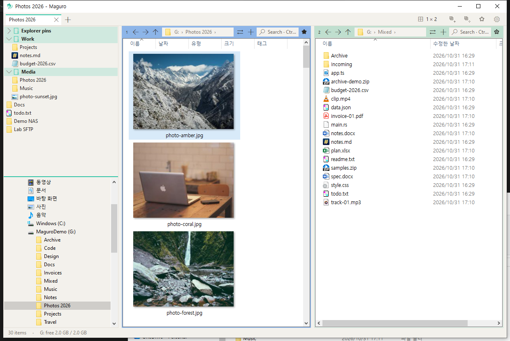
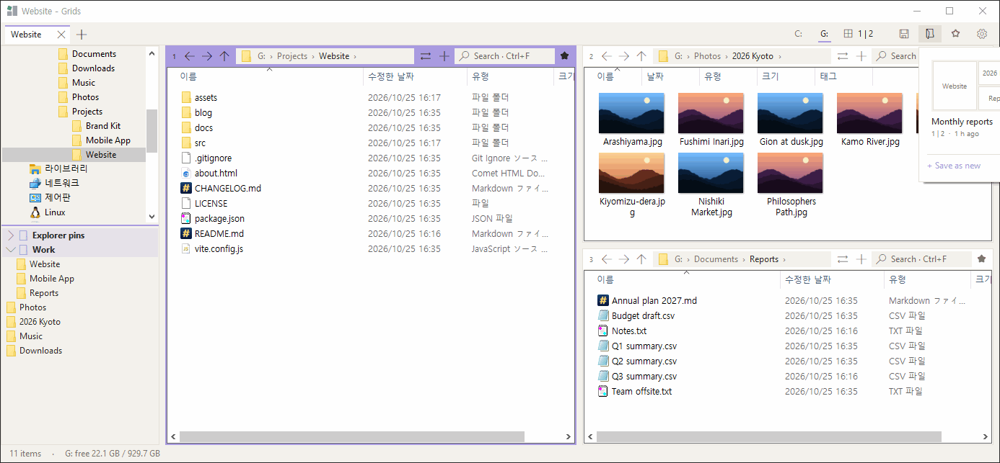
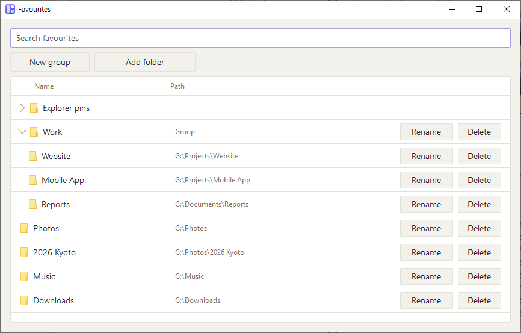
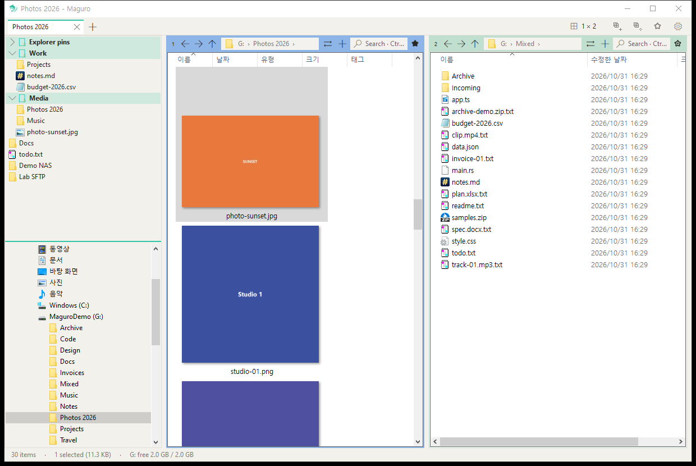
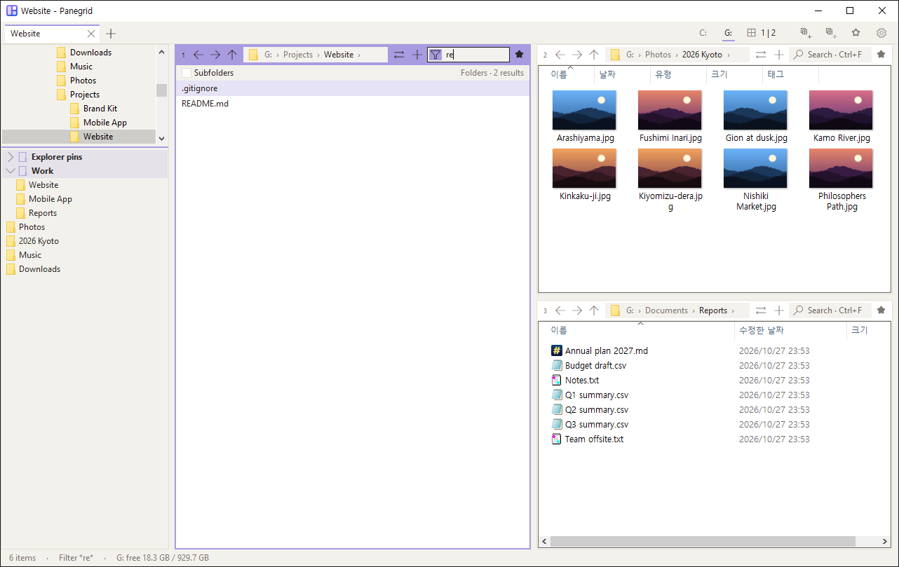
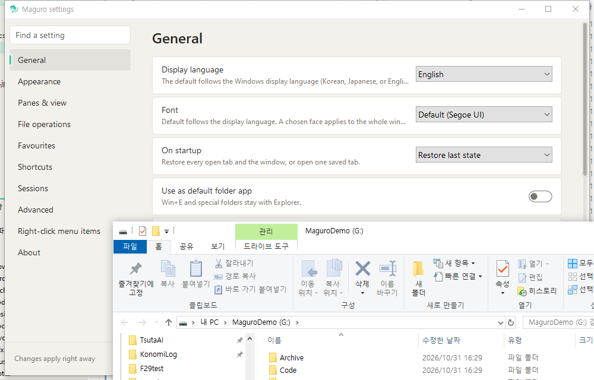

<h1 align="center">Panegrid</h1>

<p align="center">A fast, lightweight multi-pane file manager for Windows.</p>

> **Panegrid is a fork of [efww/grids](https://github.com/efww/grids)** by efww. It uses its own exe name (`panegrid.exe`), window class, settings folder and hotkey (Win+Shift+E), so it can run next to the original Grids without touching its settings.

<p align="center">
  <a href="https://github.com/Samek86/panegrid"></a>
  <a href="LICENSE"></a>
  <a href="https://github.com/Samek86/panegrid"></a>
  <a href="https://github.com/Samek86/panegrid/commits"></a>
</p>

<p align="center">
  English | <a href="README.ko.md">한국어</a>
</p>

<p align="center">
  <picture>
    <source media="(prefers-color-scheme: dark)" srcset="docs/images/hero_dark.png">
    
  </picture>
</p>

Every pane is a real Windows Explorer view: the full right-click menu, drag and drop, thumbnails, and Windows' own copy / move dialog all just work. Lay out up to 16 of them in one window, then save the whole thing as a session.

## Features

### 🧩 Multi-pane layouts & sessions

Up to 4 columns × 4 panes. Click or drag across the layout picker, drag any boundary to resize, and save layout + folders + columns as a named session you can reload in one click.

<table><tr><td></td><td></td></tr></table>

### 🗂️ Tabs that name themselves

Chrome-style window tabs plus tabs inside each pane. A tab is named after its active folder (path in the tooltip); double-click or right-click → Rename to pin your own name, and pick a tab colour.

### ⭐ Favourites popup with Explorer pins

Ctrl+B or the ★ opens a themed favourites popup: groups, nesting, drag to reorder, and your Explorer Quick-access pins right alongside.

<p align="center"></p>

### 👁️ Quick preview

Space or F3 previews pictures, PDF, Office, HTML, Markdown, code, CSV, ZIP and more. Ctrl+wheel zooms (10–800%), drag pans, the wheel scrolls, ←/→ step through files. Resizable, and it remembers its size.

<p align="center"></p>

### 🔎 Pane search via Everything

Ctrl+F in any pane filters as you type; tick Subfolders and it asks voidtools Everything for instant results (or walks the disk if Everything isn't running).

<p align="center"></p>

### 🖱️ The real Explorer, everywhere

The full Explorer context menu (shell extensions included, plus Properties on empty space), and copy / move through Windows' standard IFileOperation dialog — up to 10,000 items to another pane.

### 🎨 Themes & accent

Light and dark that follow Windows, six accent colours per theme, per-pane colours, and a settings window in English, 한국어 and 日本語.

<p align="center"></p>

📦 **One portable exe, about 1.2 MB.** Nothing to install.

## Install

Download the latest release zip, `panegrid-<version>-x64.zip`, from [Releases](https://github.com/Samek86/panegrid/releases/latest). It contains `panegrid.exe`. Unzip it into any folder and run it. One portable exe, about 1.2 MB. Nothing to install.

The exe is not code-signed, so Windows SmartScreen may warn the first time. Choose **More info → Run anyway**.

**Requirements:** Windows 10 (1903 or later) or Windows 11, x64.

Settings live in `%APPDATA%\Panegrid\panegrid.json`. Put a file named `portable.txt` next to `panegrid.exe` to keep `panegrid.json` beside the exe instead. Named sessions stay `.grids` files in the `panegrid-sessions` folder next to the exe (existing `sessions` `.grids` files are copied once).

## Build from source

Needs the Rust GNU toolchain (`x86_64-pc-windows-gnu`) and MSYS2's MinGW tools (`windres`, `dlltool`, `as` in `C:\msys64\mingw64\bin`).

```
build.cmd
```

This builds `target\release\panegrid.exe` and copies it to `build\panegrid.exe`. `icon.py` redraws the app icon (`app.ico`).

## Keyboard shortcuts

Defaults; every one can be changed in Settings → Shortcuts.

| Group | Keys | Action |
| --- | --- | --- |
| **Tabs** | Ctrl+T | New tab |
|  | Ctrl+W | Close tab |
|  | Ctrl+Tab / Ctrl+Shift+Tab | Next / previous tab |
|  | Ctrl+Shift+T | Reopen closed tab |
|  | Double-click a tab, or right-click → Rename | Rename tab (right-click also has Tab colour) |
| **Panes** | Ctrl+PgDn / Ctrl+PgUp | Next / previous pane |
|  | Ctrl+1 … 9 | Go to pane 1–9 |
|  | Alt+Shift+arrows | Move to the pane in that direction |
|  | Ctrl+Alt+Shift+arrows | Swap with the pane in that direction |
|  | Ctrl+Shift+M | Maximise / restore pane |
| **Pane tabs** | Ctrl+Alt+T / Ctrl+Alt+W | New / close pane tab |
|  | Ctrl+Alt+PgDn / PgUp | Next / previous pane tab |
| **Navigate** | Alt+← / Alt+→ | Back / forward |
|  | Alt+↑ / Alt+↓ | Parent folder / recent folders |
|  | Ctrl+L, Alt+D, F4 | Address bar |
| **View** | Ctrl+F | Search this folder (Subfolders → Everything) |
|  | Space / F3 | Quick preview |
|  | F6 / Shift+F6 | Next / previous focus |
|  | Ctrl+H | Hidden files |
|  | Ctrl+Shift+E | Left panel |
|  | Ctrl+Shift+O | Open Explorer windows' folders |
| **Preview** | Ctrl+wheel | Zoom 10–800% |
|  | Ctrl+0 | Reset zoom |
|  | Drag | Pan a zoomed picture |
|  | Wheel, ↑ / ↓, PgUp / PgDn, Home / End | Scroll |
|  | ← / → | Previous / next file |
|  | Esc / Space / F3 | Close |
| **File** | Ctrl+Shift+C | Copy full path |
|  | Num+ or Ctrl+Shift+A / Num− / Num* | Select / deselect / invert by pattern |
|  | Ctrl+Alt+N | New text file |
|  | Ctrl+Shift+N, F7 | New folder |
|  | F2, Del, Ctrl+C / X / V, F5 | Same as Explorer (Ctrl+V of a picture saves a PNG) |
| **Other** | Ctrl+B | Favourites popup |
|  | Ctrl+S | Save session |
|  | Ctrl+, | Settings |
|  | F1 / Ctrl+/ | Shortcut help / list |
|  | Ctrl+N | New window |
|  | Win+Shift+E | Bring Panegrid to front |

## Settings

The gear on the tab row opens the view menu. Settings is in that menu (`Ctrl+,`).

Panegrid stores settings in `%APPDATA%\Panegrid\panegrid.json`. A file named `portable.txt` next to `panegrid.exe` keeps `panegrid.json` beside the exe instead. Named sessions are `.grids` files in the `panegrid-sessions` folder next to the exe; `.grids` files already in a `sessions` folder are copied once. On first run, if `panegrid.json` is missing, it is copied from a previous Panegrid or Samek86 Grids file (`%APPDATA%\grids\grids.json`, or `grids.json` next to the exe). Otherwise `grids.ini` or `qdir.ini` is imported read-only. Source files are never renamed, modified, or deleted (no `.bak`). An older `lang=ko` in `grids.ini` still loads as Korean.

The file is replaced atomically. A failed write is tried again in 5 seconds. A file that cannot be read is left alone (Retry or Cancel, never overwritten with defaults). Unknown keys are kept. Minimizing keeps a maximized window maximized.

The default follows the Windows display language (Korean, Japanese, or English); otherwise English. Auto, English, 한국어, or 日本語 can be chosen, stored as `"lang": "auto"`, `"en"`, `"ko"`, or `"ja"`. Explorer parts inside each pane, such as column names and right-click menus, follow the Windows display language. The font defaults to that language's face (Segoe UI, Malgun Gothic, Yu Gothic UI). A chosen face applies to the whole window at once (`font_face`). There is no font size setting, and an older `font` value is ignored.

View → Show file extensions is Windows' own setting, the same one Explorer uses, and it is on the Settings page too. View → Follow Windows light / dark is the check for a new install. View → Dark theme or Light theme picks light or dark by hand and turns following off. Lists are recoloured in place, so history, the filter, the selection, the scroll position, and an address being typed stay.

| Key | Notes |
| --- | --- |
| `side_split` | Divider between the folder tree and favourites. Restored on startup. Settings can hide the whole left panel. |
| `use_everything` | On unless `"use_everything": false`. Subfolder search then asks Everything when it is running. Settings → General shows Installed and running, Installed but not running, or Not installed, plus the version when Everything answers. Start Everything launches the installed `Everything.exe`. Install runs `winget install --id voidtools.Everything -e` when winget is available, and otherwise opens the voidtools download page. |
| `ev_asked` | Remembers the answer to the one-time install prompt. The first subfolder search without Everything installed asks once. |
| `drive_buttons` | On when the key is missing. Settings → Appearance → Show drive buttons hides them and gives that space to the tabs. A narrow window hides the last letters first. |
| `layout_new` | Default layout for a first start and a new window: two panes side by side, top and bottom, 2×2, or one pane. A path handed over by another launch opens as a one-pane tab. A new window tab (+ or Ctrl+T) copies the current tab's layout instead. |
| `hotkey` | On when the line is missing. Win+Shift+E brings Panegrid forward; press again to minimize. If a Panegrid dialog is open, that dialog comes forward. View shows a check only while the key is really registered, so one click retries after a failed start. The shortcut can be changed in Settings. |
| `space_preview` | On when the key is missing. Settings → Panes & view → Preview with Space turns this off. A space within a second of typing a name, or while Korean or Japanese IME text is being composed, stays part of that name. Ctrl+Space and Shift+Space are left alone. |
| `folders` | Folders open as pane tabs, stored on each pane, and in named sessions. An older `pane_tabs` value is ignored. |
| `favorites_tree` | The favourites tree. An older flat list is moved into the root. |
| `one_window` | Single-window mode. Off when the line is missing. Another launch restores a minimized window and opens path arguments as tabs in that window. Ctrl+N, dragging a tab off the strip, Move to new window, and Win+Shift+E while Panegrid is already in front open a tab here instead of a window. |
| `lang` | `"auto"`, `"en"`, `"ko"`, or `"ja"`. A missing key, like `"auto"`, follows the Windows display language (Korean, Japanese, or English); otherwise English. |
| `font_face` | Font for the whole window. No font size is stored. An older `font` value is ignored. |

## Roadmap

- [ ] Code-signed builds, so SmartScreen does not warn the first time you run `panegrid.exe`
- [ ] Interface languages beyond English, 한국어, and 日本語

## Credits

Panegrid is a fork of [efww/grids](https://github.com/efww/grids) by efww.

Inspired by [Q-Dir](https://www.softwareok.com/?seite=Freeware/Q-Dir) and [voidtools Everything](https://www.voidtools.com/). Panegrid is an independent project, not affiliated with Q-Dir or its author.

## License

[MIT](LICENSE)
