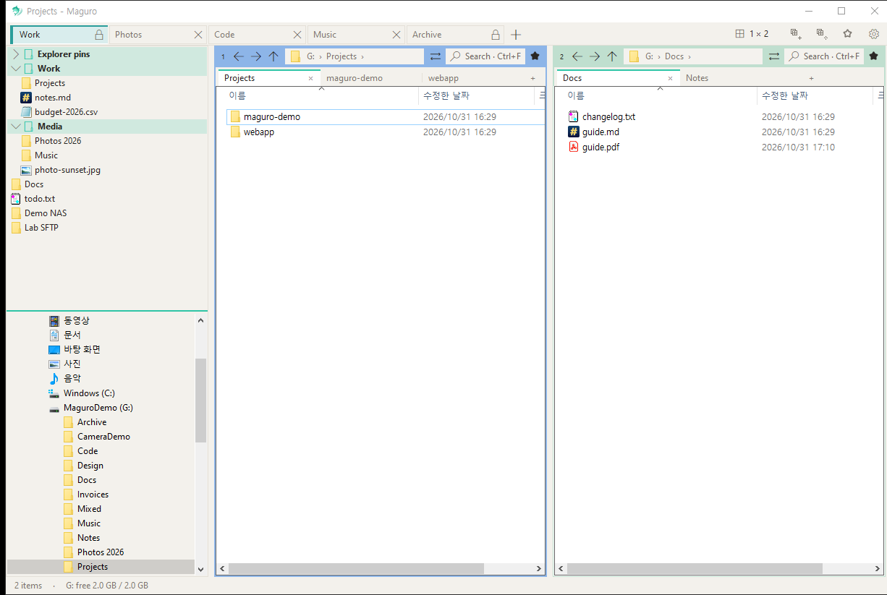
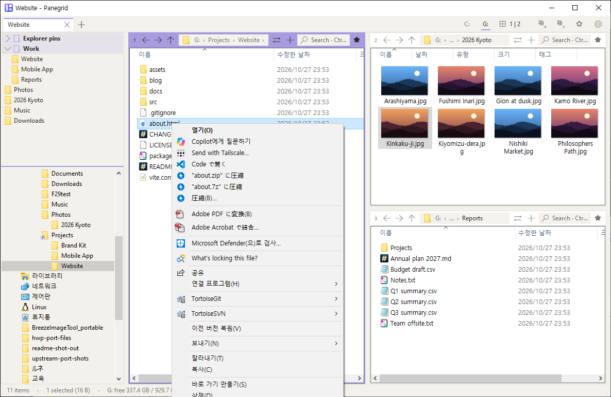

  <picture>
    <source media="(prefers-color-scheme: dark)" srcset="assets/panegrid-lockup-dark.png">
    <source media="(prefers-color-scheme: light)" srcset="assets/panegrid-lockup-light.png">
    
  </picture>

<h1 align="center">Panegrid</h1>

A fast, lightweight multi-pane file manager for Windows.

> **Panegrid is a fork of [efww/grids](https://github.com/efww/grids)** by efww. It uses its own exe name (`panegrid.exe`), window class, settings folder and hotkey (Win+Shift+E), so it can run next to the original Grids without touching its settings.

  
  
  
  

  English | <a href="README.ko.md">한국어</a>

  <picture>
    <source media="(prefers-color-scheme: dark)" srcset="docs/images/hero_dark.png">
    
  </picture>

Every pane is a real Windows Explorer view: the full right-click menu, drag and drop, thumbnails, and Windows' own copy / move dialog all just work. Lay out up to 16 of them in one window, then save the whole thing as a session.

## Features

### 🧩 Multi-pane layouts & sessions

Up to 4 columns × 4 panes. Click or drag across the layout picker, drag any boundary to resize, and save layout + folders + columns as a named session you can reload in one click.

<table><tr><td></td><td></td></tr></table>

### 🗂️ Tabs that name themselves

Chrome-style window tabs plus tabs inside each pane. A tab is named after its active folder (path in the tooltip); double-click or right-click → Rename to pin your own name, and pick a tab colour.

### ⭐ Favourites popup with Explorer pins

The ★ on the toolbar opens a themed favourites popup: your Explorer Quick-access pins at the top, then your own groups, with nesting and drag to reorder. Ctrl+B opens the quick favourites list.

### 👁️ Quick preview

Space or F3 previews pictures, PDF, Office, HTML, Markdown, code, CSV, ZIP and more. Ctrl+wheel zooms (10–800%), drag pans, the wheel scrolls, ←/→ step through files. Resizable, and it remembers its size.

### 🔎 Pane search via Everything

Ctrl+F in any pane filters as you type; tick Subfolders and it asks voidtools Everything for instant results (or walks the disk if Everything isn't running).

### 🖱️ The real Explorer, everywhere

The full Explorer context menu (shell extensions included, plus Properties on empty space), and copy / move through Windows' standard IFileOperation dialog — up to 10,000 items to another pane.

### 🎨 Themes & accent

Light and dark that follow Windows, six accent colours per theme, per-pane colours, and a settings window in English, 한국어 and 日本語.

📦 **One portable exe, about 1.2 MB.** Nothing to install.

## Install

Download the latest release zip, `panegrid-<version>-x64.zip`, from [Releases](https://github.com/Samek86/panegrid/releases/latest). It contains `panegrid.exe`. Unzip it into any folder and run it. One portable exe, about 1.2 MB. Nothing to install.

The exe is not code-signed, so Windows SmartScreen may warn the first time. Choose **More info → Run anyway**.

**Requirements:** Windows 10 (1903 or later) or Windows 11, x64.

Settings live in `%APPDATA%\Panegrid\panegrid.json`. Put a file named `portable.txt` next to `panegrid.exe` to keep `panegrid.json` beside the exe instead. Named sessions stay `.grids` files in the `panegrid-sessions` folder next to the exe (existing `sessions` `.grids` files are copied once).

To build from source, see [CONTRIBUTING.md](CONTRIBUTING.md).

## Keyboard shortcuts

Defaults; every one can be changed in Settings → Shortcuts.

| Group | Keys | Action |
| --- | --- | --- |
| **Tabs** | Ctrl+T | New tab |
|  | Ctrl+W | Close tab |
|  | Ctrl+Tab / Ctrl+Shift+Tab | Next / previous tab |
|  | Ctrl+Shift+T | Reopen closed tab |
|  | Double-click a tab | Rename tab |
| **Panes** | Ctrl+PgDn / Ctrl+PgUp | Next / previous pane |
|  | Ctrl+1 … 9 | Go to pane 1–9 |
|  | Alt+Shift+arrows | Move to the pane in that direction |
|  | Ctrl+Alt+Shift+arrows | Swap with the pane in that direction |
|  | Ctrl+Shift+M | Maximise / restore pane |
| **Pane tabs** | Ctrl+Alt+T / Ctrl+Alt+W | New / close pane tab |
|  | Ctrl+Alt+PgDn / PgUp | Next / previous pane tab |
| **Navigate** | Alt+← / Alt+→ | Back / forward |
|  | Alt+↑ / Alt+↓ | Parent folder / recent folders |
|  | Ctrl+L, Alt+D, F4 | Address bar |
| **View** | Ctrl+F | Search this folder (Subfolders → Everything) |
|  | Space / F3 | Quick preview |
|  | F6 / Shift+F6 | Next / previous focus |
|  | Ctrl+Shift+E | Left panel |
| **Preview** | Ctrl+wheel | Zoom 10–800% |
|  | Ctrl+0 | Reset zoom |
|  | Drag | Pan a zoomed picture |
|  | Wheel, ↓, PgDn, Home / End | Scroll |
|  | ← / → | Previous / next file |
|  | Esc / Space / F3 | Close |
| **File** | Ctrl+Shift+C | Copy full path |
|  | Num+ or Ctrl+Shift+A / Num− / Num* | Select / deselect / invert by pattern |
|  | Ctrl+Alt+N | New text file |
|  | Ctrl+Shift+N, F7 | New folder |
|  | F2, Del, Ctrl+C / V, F5 | Same as Explorer |
| **Other** | Ctrl+B | Quick favourites list |
|  | Ctrl+S | Save session |
|  | Ctrl+, | Settings |
|  | F1 / Ctrl+/ | Shortcut help / list |
|  | Ctrl+N | New window |

## Settings

The gear on the tab row opens the view menu. Settings is in that menu (`Ctrl+,`).

Language (Auto, English, 한국어, 日本語), font, light / dark theme, and shortcuts are all set there. Migration from older Grids settings, how the file is written, and the full `panegrid.json` key table are in [docs/settings.md](docs/settings.md).

## Roadmap

- [ ] Code-signed builds, so SmartScreen does not warn the first time you run `panegrid.exe`
- [ ] Interface languages beyond English, 한국어, and 日本語

## Credits

Panegrid is a fork of [efww/grids](https://github.com/efww/grids) by efww.

Inspired by [Q-Dir](https://www.softwareok.com/?seite=Freeware/Q-Dir) and [voidtools Everything](https://www.voidtools.com/). Panegrid is an independent project, not affiliated with Q-Dir or its author.

## License

[MIT](LICENSE)
